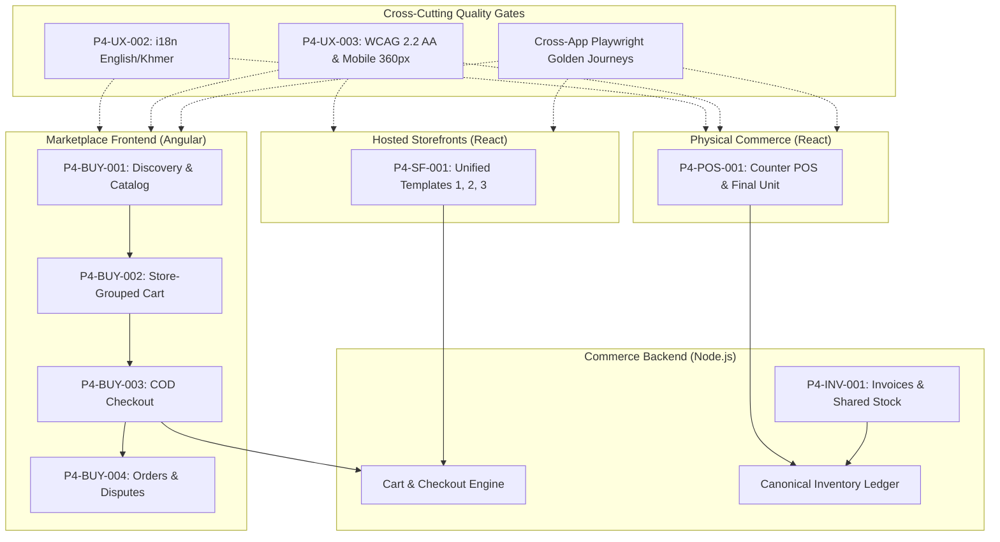
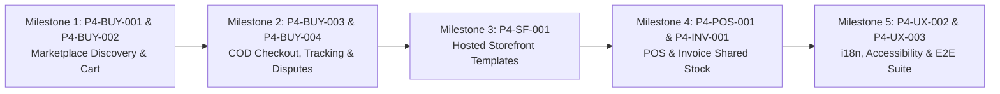

# Phase 4 Customer Journeys — Implementation Map & Audit

**Document ID:** P4-MAP-001<br/>
**Date:** 2026-10-26<br/>
**Author / Lead:** Gemini Workstream (Customer Journeys & Cross-Application Quality)<br/>
**Branch:** `feature/p4-customer-journeys`<br/>
**Worktree:** `/Users/macbookpro/Desktop/Development/Rentify-P4-Customer`<br/>
**Base Commit SHA:** `9503e129dd2533b6aa45559868512f451f2e1a38` (Merge pull request #17: Phase 2 delivery gate)<br/>
**Governing Documents:**
- [`docs/specs/release-1-golden-journeys.md`](../specs/release-1-golden-journeys.md) — Five Golden Journeys (GJ1–GJ5)
- [`docs/ai-implementation-plan.md`](../ai-implementation-plan.md) — Phase 4 Work Packages
- [`docs/master-engineering-blueprint.md`](../master-engineering-blueprint.md) — Master Architecture & Contracts
- [`docs/platform-architecture.md`](../platform-architecture.md) — Platform Domain Boundaries

---

## 1. Executive Summary & Ownership Boundary

Phase 4 turns the authoritative commerce and transactional foundation established in Phases 1–3 into coherent, dependable, accessible, and bilingual customer outcomes across all three sales channels: **the shared Rentify Marketplace**, **hosted merchant storefronts**, and **the physical counter POS**.

### 1.1. Exclusive Ownership (Gemini Workstream)

| Package ID | Package Title | Target Surface / Scope | Primary Framework |
| :--- | :--- | :--- | :--- |
| **`P4-BUY-001`** | Marketplace Discovery | Home, categories, search, filtering, product & store detail, SEO metadata, safe unavailable states. | Angular (`marketplace-frontend`) |
| **`P4-BUY-002`** | Store-Grouped Cart | Multi-Store cart grouping, independent Store checkout, quote re-evaluation, stock/price change alerts. | Angular (`marketplace-frontend`) |
| **`P4-BUY-003`** | COD Checkout & Confirmation | Single-page delivery form, COD policy acknowledgement, idempotent order placement, refresh-safe confirmation. | Angular (`marketplace-frontend`) |
| **`P4-BUY-004`** | Order History, Tracking & Disputes | Event-derived order timeline, delivery tracking, return/complaint filing with photo upload, SLA deadline clock. | Angular (`marketplace-frontend`) |
| **`P4-SF-001`** | Hosted Storefront Full Journey | Unify templates 1, 2, 3 to consume canonical shared checkout, cart, catalog adapters; suspension states. | React (`rentify-frontend/apps/storefront` & `templates`) |
| **`P4-POS-001`** | POS Shared-Stock Journey | Barcode scanning, SKU lookup, exact totals, receipt printing, offline/timeout guidance, final-unit concurrency race. | React (`rentify-frontend/apps/core/pos`) |
| **`P4-INV-001`** | Invoice Shared-Stock Journey | Quote vs invoice vs order semantics, legal state machine, payment recording, ledger stock deduction, PDF receipt. | Node/Express (`ecommerce-server/modules/invoices`) |
| **`P4-UX-002`** | Internationalization & Content Enforcement | Complete English/Khmer parity across Angular marketplace and POS; missing-key CI gate; Khmer typography. | Cross-Application (`marketplace-frontend`, `pos`, `libs/utils`) |
| **`P4-UX-003`** | Accessibility & Weak-Network Pass | Automated Axe-core a11y gates, WCAG 2.2 AA contrast, 44x44px touch targets on 360px viewports, weak-network retry. | Cross-Application |
| **Quality Tooling** | Cross-Application Browser & E2E Tooling | Playwright test suites for Golden Journeys 1–5, race condition suites, and contract validation. | Tooling (`tools/e2e/`, `tests-playwright/`) |

### 1.2. Strict Codex Boundary Defense (Do Not Touch)

Codex separately owns the Merchant Dashboard and work packages `P4-MER-000` through `P4-MER-005`. To ensure zero conflicts:
1. **Never edit any file in `rentify-frontend/apps/core/merchant/`**.
2. **Never edit any file in `admin-frontend/`**.
3. **Never enable or implement CutLuy checkout**; Release 1 Phase 4 checkout remains strictly Cash on Delivery (COD).
4. **Isolate all customer, POS, and storefront logic** in `marketplace-frontend/`, `rentify-frontend/apps/storefront/`, `rentify-frontend/apps/templates/`, `rentify-frontend/apps/core/pos/`, and `ecommerce-server/modules/invoices/`.

---

## 2. Phase 3 Backend Dependencies & Integration Baseline

The worktree was initialized from `origin/develop` at commit `9503e12` (Phase 2 delivery gate). Phase 3 capabilities were implemented on branch `codex/phase-3` and submitted as Pull Request #18 (`Phase 3: canonical catalog, inventory, orders, and COD`).

Every owned Phase 4 package integrates directly with Phase 3 contracts:

| Phase 4 Package | Phase 3 Contract Dependency | Backend Capability Provided |
| :--- | :--- | :--- |
| `P4-BUY-001` | `P3-CAT-001`, `P3-CAT-002` | Canonical SKU variants (`ProductVariants`); centralized publication eligibility engine; public-safe reason codes. |
| `P4-BUY-002` | `P3-CART-001`, `P3-MNY-001` | Channel-safe Store carts; server-priced quotes in integer cents (`USD`); stock change warnings. |
| `P4-BUY-003` | `P3-MNY-001`, `P3-COD-001`, `P3-EVT-001` | Integer minor financial totals; COD state machine; idempotent place-order via `Idempotency-Key` and transactional outbox. |
| `P4-BUY-004` | `P3-ORD-001`, `P3-COD-001` | Order and fulfillment state machines; cancellation inventory restoration; refund reconciliation. |
| `P4-SF-001` | `P3-CAT-001`, `P3-INV-002.2` | Storefront checkout canonical ledger integration; shared product/variant resolution. |
| `P4-POS-001` | `P3-INV-002.3`, `P3-INV-003` | Row-level locked (`SELECT FOR UPDATE`) POS order creation; zero negative stock; 409 conflict envelope. |
| `P4-INV-001` | `P3-INV-002.4`, `P3-ORD-001` | Invoice fulfillment stock deduction via canonical inventory ledger; non-double-deduction invariants. |

> [!IMPORTANT]
> When PR #18 (`codex/phase-3`) is merged into `develop` (or when `codex/phase-3` is rebased/merged into `feature/p4-customer-journeys`), all backend models, migration files, and services will be active in the worktree. Until then, Phase 4 frontend implementations target the agreed OpenAPI contracts in `docs/openapi/commerce.openapi.yaml`.

---

## 3. Package-by-Package Audit & Implementation Map



---

### 3.1. P4-BUY-001 — Marketplace Discovery

- **Objective:** Provide a fast, accessible, responsive discovery experience covering Home, Categories, Search, Store Detail, and Product Detail with SEO metadata and safe unavailable states.
- **Existing Behavior:**
  - `HomeComponent`, `ProductsComponent`, `CategoriesComponent`, `CategoryDetailComponent`, `StoresComponent`, `StoreDetailComponent`, `ProductDetailComponent` are lazy-loaded in Angular router.
  - Queries `CommerceApiService` and `RentifyMarketplaceService`.
- **Missing Behavior (Gaps):**
  - **Variant SKU Picker**: `ProductDetailComponent` treats products as single-SKU; lacks option selectors (Size, Color) resolving to specific `ProductVariants` with distinct price and stock.
  - **Safe Unavailable Reason Codes**: Does not inspect `eligibility` reason codes (e.g., `OUT_OF_STOCK`, `SELLER_UNAPPROVED`); out-of-stock items still show an active "Add to Cart" button.
  - **Search Zero-Result Recovery**: Blank page when search query yields 0 results; lacks suggestions, trending categories, or spelling recovery.
  - **SEO & Meta Tags**: Missing OpenGraph meta tags, canonical link headers, and JSON-LD schema on product and store pages.
  - **Telemetry & Skeletons**: Missing loading skeleton cards and search query latency timing.
- **Exact Ownership:**
  - Frontend: `marketplace-frontend/src/app/pages/` (`home.component.ts`, `products.component.ts`, `product-detail.component.ts`, `categories.component.ts`, `category-detail.component.ts`, `stores.component.ts`, `store-detail.component.ts`), `marketplace-frontend/src/app/core/catalog/`.
  - Backend: `ecommerce-server/modules/store-catalog/` (`storeCatalogRoutes.js`, `storeCatalogService.js`).
- **Expected Files & Tests:**
  - `marketplace-frontend/src/app/components/user/catalog/variant-picker/variant-picker.component.ts`
  - `marketplace-frontend/src/app/components/user/search/search-zero-state/search-zero-state.component.ts`
  - `marketplace-frontend/src/app/core/seo/seo.service.ts`
  - Unit Tests: `product-detail.component.spec.ts`, `products.component.spec.ts`, `variant-picker.component.spec.ts`

---

### 3.2. P4-BUY-002 — Store-Grouped Cart

- **Objective:** Deliver multi-Store cart grouping with independent Store checkout, server-quoted delivery fees, stock change warnings, and guest-to-buyer merging.
- **Existing Behavior:**
  - `CartService` holds `guestItems` in localStorage and `storeCarts` in memory.
  - `CartComponent` groups items by `storeId`.
- **Missing Behavior (Gaps):**
  - **Client-Side Hardcoded Shipping**: `SHIPPING_FLAT_RATE = 3.5` and `FREE_SHIPPING_THRESHOLD = 50` are hardcoded in `cart.service.ts`! Violates financial invariant: delivery fees must come strictly from Commerce API.
  - **Independent Store Checkout**: Buyer cannot select a single Store group to check out; clicking checkout proceeds to a combined checkout or checks out all stores sequentially.
  - **Preserved Unselected Baskets**: Unselected Store groups must remain in the cart without data loss when checking out another Store.
  - **Stock & Price Change Explanations**: Stale items or price changes must render an inline alert with "Accept Updated Quote" or "Update Quantity" recovery actions.
  - **Variant Option Display**: Cart lines show only product name; must show selected variant attributes (e.g. `Size: L, Color: White`).
- **Exact Ownership:**
  - Frontend: `marketplace-frontend/src/app/core/cart/cart.service.ts`, `marketplace-frontend/src/app/pages/cart.component.ts`.
  - Backend: `ecommerce-server/modules/cart/` (`cartRoutes.js`, `cartService.js`).
- **Expected Files & Tests:**
  - `marketplace-frontend/src/app/core/cart/cart.service.ts` (refactored to consume server quote)
  - `marketplace-frontend/src/app/pages/cart.component.ts` (store selection & inline stock change alerts)
  - Unit Tests: `cart.service.spec.ts`, `cart.component.spec.ts`

---

### 3.3. P4-BUY-003 — COD Checkout & Confirmation

- **Objective:** Streamlined single-page checkout for Cash on Delivery with phone/address validation, policy acknowledgement, idempotent submission, and refresh-safe confirmation.
- **Existing Behavior:**
  - `CheckoutComponent` provides delivery form and payment option selection (COD active, others marked coming soon).
  - `OrderSuccessComponent` renders confirmation card and reads from `sessionStorage`.
- **Missing Behavior (Gaps):**
  - **Single Store Group Scoping**: Must check out the selected Store group with exact quote verification (`expectedTotal === serverQuote`).
  - **COD Policy Acknowledgement**: Missing required disclaimer and checkbox confirming that the buyer will pay the courier in cash upon arrival.
  - **Refresh-Safe Confirmation**: Currently loses details if refreshed after session storage clears; must load order details via `GET /api/marketplace/orders/public/:orderNumber` (authenticated or public token).
  - **Idempotency & Network Retry**: Ensure repeated button taps or network retries reuse the same `Idempotency-Key` and safely display the confirmed order.
- **Exact Ownership:**
  - Frontend: `marketplace-frontend/src/app/pages/checkout.component.ts`, `marketplace-frontend/src/app/pages/order-success.component.ts`.
  - Backend: `ecommerce-server/modules/checkout/` (`marketplaceCheckoutService.js`, `marketplaceCheckoutRoutes.js`).
- **Expected Files & Tests:**
  - `marketplace-frontend/src/app/pages/checkout.component.ts`
  - `marketplace-frontend/src/app/pages/order-success.component.ts`
  - Unit Tests: `checkout.component.spec.ts`, `order-success.component.spec.ts`

---

### 3.4. P4-BUY-004 — Order History, Tracking, Return & Complaint

- **Objective:** Buyer order tracking with event-derived timeline, cancellation within pending window, and 7-day post-delivery dispute/return filing with photo evidence.
- **Existing Behavior:**
  - `Orders` component loads buyer orders from `rentify.orders()`.
  - Cancel button calls dummy `report` endpoint.
- **Missing Behavior (Gaps):**
  - **Event-Derived Timeline**: Currently `timeline: []` is empty! Must render live lifecycle events (`PENDING` -> `ACCEPTED` -> `SHIPPED` -> `DELIVERED`).
  - **Dispute & Return Modal (Golden Journey 4)**:
    - 7-day eligibility gate after delivery.
    - Reason selector: `DAMAGED_ON_ARRIVAL`, `WRONG_ITEM`, `DEFECTIVE`, `NOT_AS_DESCRIBED`.
    - Photo evidence upload (JPG/PNG/WebP, max 5MB).
    - 48-business-hour response SLA countdown timer displayed to buyer.
    - Refund status display: reveals whether merchant has executed direct cash/Bakong payout and transaction reference (`refNumber`).
- **Exact Ownership:**
  - Frontend: `marketplace-frontend/src/app/features/user/account/orders/orders.ts`, `marketplace-frontend/src/app/components/shared/orders/`.
  - Backend: `ecommerce-server/modules/orders/` (`orderRoutes.js`, `marketplaceOrderService.js`, `orderEventService.js`).
- **Expected Files & Tests:**
  - `marketplace-frontend/src/app/components/shared/orders/order-timeline/order-timeline.component.ts`
  - `marketplace-frontend/src/app/components/shared/orders/dispute-modal/dispute-modal.component.ts`
  - Unit Tests: `orders.spec.ts`, `dispute-modal.component.spec.ts`

---

### 3.5. P4-SF-001 — Hosted Storefront Full Journey

- **Objective:** Unify all three storefront templates (`ecommerce-template-1`, `ecommerce-template-2`, `ecommerce-template-3`) to consume canonical shared adapters from `@rentify/storefront/` and share uniform transaction semantics.
- **Existing Behavior:**
  - Each template has duplicated `CartView.jsx`, `CheckoutForm.jsx`, `ProductPurchasePanel.jsx`, and custom hooks.
  - `StorefrontShell.jsx` resolves domain via `useGetWebsiteByDomainQuery`.
- **Missing Behavior (Gaps):**
  - **Divergent Checkout Logic**: Templates duplicate validation and checkout submission logic instead of consuming `@rentify/storefront/checkout` and `@rentify/storefront/cart`.
  - **Variant SKU Selection**: Templates do not support multi-variant SKU picking backed by canonical `ProductVariants`.
  - **Suspension / Maintenance States**: If a store or website is suspended or in draft, templates fail abruptly rather than displaying a graceful branded notice.
  - **Shared Failure Semantics**: Out-of-stock and quote conflict errors lack consistent toast and recovery actions across templates.
- **Exact Ownership:**
  - Frontend: `rentify-frontend/apps/storefront/**`, `rentify-frontend/apps/templates/ecommerce/**`, `rentify-frontend/libs/storefront/**`.
  - Backend: `ecommerce-server/modules/checkout/storefrontCheckoutRoutes.js`, `ecommerce-server/modules/websites/`.
- **Expected Files & Tests:**
  - `rentify-frontend/libs/storefront/src/adapters/canonicalStorefrontCart.ts`
  - `rentify-frontend/apps/templates/ecommerce/ecommerce-template-1/src/components/CheckoutForm.jsx`
  - `rentify-frontend/apps/templates/ecommerce/ecommerce-template-2/src/components/CheckoutForm.jsx`
  - `rentify-frontend/apps/templates/ecommerce/ecommerce-template-3/src/components/CheckoutForm.jsx`
  - Unit Tests: `storefrontCheckout.test.jsx`, `templateConsistency.test.jsx`

---

### 3.6. P4-POS-001 — POS Shared-Stock Journey

- **Objective:** Counter POS register supporting barcode scanning, SKU lookup, exact totals, receipt printing, offline/timeout guidance, and last-unit concurrency protection against online buyers.
- **Existing Behavior:**
  - `rentify-frontend/apps/core/pos/` provides `POS.jsx`, `POSLayout.jsx`, cash denominations, barcode input.
- **Missing Behavior (Gaps):**
  - **ESLint Failures**: `@typescript-eslint/no-empty-function` in `POSLayout.jsx` (lines 44, 82, 85).
  - **Canonical SKU & Barcode Resolution**: Must resolve items against canonical `ProductVariants` by barcode or SKU.
  - **Final-Unit Concurrency Alert (Golden Journey 3)**: When POS contests the last unit and loses to an online order, handle `409 OUT_OF_STOCK` gracefully with an audible/visual alert and cart adjustment.
  - **Offline Resilience**: Queue completed offline cash transactions in IndexedDB with sequential playback upon network reconnect.
  - **Receipt Formatter**: Generate printable/thermal receipts showing store name, cashier name, date/time, line items, tax, USD & KHR totals, and cash tendered/change.
- **Exact Ownership:**
  - Frontend: `rentify-frontend/apps/core/pos/**`.
  - Backend: `ecommerce-server/modules/orders/storePosRoutes.js`, `OrderController.createPOSOrder`.
- **Expected Files & Tests:**
  - `rentify-frontend/apps/core/pos/src/lib/posReceiptPrinter.js`
  - `rentify-frontend/apps/core/pos/src/lib/offlineQueue.js`
  - `rentify-frontend/apps/core/pos/src/components/layout/POSLayout.jsx` (lint fix)
  - Unit Tests: `pos.test.jsx`, `posBarcodeLookup.test.js`, `posConcurrency.test.js`

---

### 3.7. P4-INV-001 — Invoice Shared-Stock Journey

- **Objective:** Formalize quote vs. invoice vs. order semantics, legal state transitions, receipt/payment recording, and canonical ledger stock deduction without double-counting.
- **Existing Behavior:**
  - `ecommerce-server/modules/invoices/` has `getInvoices` and `getInvoicePdf`. Creation route was commented out.
- **Missing Behavior (Gaps):**
  - **Quote vs Invoice vs Order Semantics**:
    - `Quote`: Non-binding estimate; zero stock reservation or deduction.
    - `Invoice`: Issued payment obligation; payment confirmation creates order and reserves stock.
    - `Fulfillment`: Finalizes stock deduction via canonical inventory ledger.
  - **State Machine**: Legal transitions (`draft` -> `sent` -> `partially_paid` -> `paid` -> `fulfilled` / `cancelled` / `void`).
  - **Public Customer Invoice Link**: Token-authenticated public view for buyers to view invoice, details, and receipt.
  - **No Double Stock Deductions**: Reconciles with orders to ensure invoices linked to existing orders do not re-deduct stock.
- **Exact Ownership:**
  - Frontend: Shared customer invoice tracking view.
  - Backend: `ecommerce-server/modules/invoices/` (`invoiceRoutes.js`, `invoiceController.js`, `invoiceFulfillmentService.js`).
- **Expected Files & Tests:**
  - `ecommerce-server/modules/invoices/invoiceLifecycleService.js`
  - `ecommerce-server/modules/invoices/invoicePublicRoutes.js`
  - Unit/Integration Tests: `invoiceLifecycle.test.js`, `invoiceStockReconciliation.test.js`

---

### 3.8. P4-UX-002 — Internationalization & Content Enforcement

- **Objective:** Complete English (`en`) and Khmer (`kh`) language parity across all owned customer surfaces, missing-key CI verification, currency and date formatting, and Khmer typography support.
- **Existing Behavior:**
  - `rentify-frontend/libs/utils/src/locales/` contains `en.json` and `kh.json`.
  - Storefront templates have localized `i18n.jsx`.
- **Missing Behavior (Gaps):**
  - **Marketplace Hardcoded English**: `marketplace-frontend` has zero translation infrastructure! Every button, title, crumb, and error string is in English.
  - **POS Hardcoded English**: POS register interface has zero i18n support.
  - **Missing-Key CI Gate**: No automated test verifies that every key in `en.json` exists in `kh.json`.
  - **Khmer Typography & 360px Line Heights**: Khmer script requires 1.6+ line-height and specific font declarations (`Kantumruy Pro`, `Battambang`) to avoid clipping.
- **Exact Ownership:**
  - `marketplace-frontend/src/app/core/i18n/` (new Angular translation service and pipes).
  - `marketplace-frontend/src/assets/i18n/` (`en.json`, `kh.json`).
  - `rentify-frontend/apps/core/pos/` (bilingual toggle and locales).
  - `tools/i18n/verify-translations.mjs` (CI validation script).
- **Expected Files & Tests:**
  - `marketplace-frontend/src/app/core/i18n/translate.service.ts`
  - `marketplace-frontend/src/app/core/i18n/translate.pipe.ts`
  - `tools/i18n/verify-translations.mjs`
  - Unit Tests: `translate.service.spec.ts`, `i18nParity.test.js`

---

### 3.9. P4-UX-003 — Accessibility & Weak-Network Pass

- **Objective:** Automated Axe-core accessibility enforcement, WCAG 2.2 AA contrast ratios, 44x44px touch targets on 360px mobile viewports, screen reader live regions, and weak-network resilience.
- **Existing Behavior:**
  - `packages/design-tokens/contrast-validator.js` enforces semantic color contrast.
- **Missing Behavior (Gaps):**
  - **Automated Axe-Core Audits**: No automated accessibility tests run against live pages in CI.
  - **Touch Target Enforcements**: Mobile quantity steppers, icon buttons, and filter toggles are smaller than 44x44px on 360px viewports.
  - **Live Regions (`aria-live`)**: Screen readers receive no audio feedback when items are added to cart, cart quantity changes, or search results update.
  - **Image Fallback Skeletons**: Broken CDN images display standard browser broken icon rather than a branded SVG placeholder with product title.
  - **Weak-Network Retry**: Requests hanging over 10 seconds lack a visible retry banner ("Connection slow, tap to retry").
- **Exact Ownership:**
  - Owned customer surfaces in `marketplace-frontend`, `storefront`, `templates`, and `pos`.
  - Tooling: `@axe-core/playwright` integration in `tools/e2e/`.
- **Expected Files & Tests:**
  - `tools/e2e/accessibilityValidator.js`
  - `packages/design-tokens/touch-target-check.js`
  - Automated Axe tests on Golden Journeys 1–4.

---

### 3.10. Cross-Application Browser & Quality Enforcement Tooling

- **Objective:** End-to-end browser test harness executing the five Golden Journeys on local and staging environments with contract and accessibility assertions.
- **Existing Behavior:**
  - `tools/e2e/journeys/buyerJourney.js`, `merchantJourney.js`, `safetyAndFailureJourney.js`.
- **Missing Behavior (Gaps):**
  - **Golden Journey 2 (Storefront Omnichannel)**: Automated test proving that a purchase on `aura.rentifystore.shop` deducts inventory from the central marketplace listing.
  - **Golden Journey 3 (POS Concurrency Race)**: Automated race condition test where POS and online checkout compete for the last unit simultaneously.
  - **Golden Journey 4 (Buyer Dispute & Return)**: Automated test submitting a dispute with photo evidence, awaiting merchant response, and verifying refund status.
- **Exact Ownership:**
  - `tools/e2e/journeys/` (`storefrontOmnichannelJourney.js`, `posConcurrencyJourney.js`, `buyerDisputeJourney.js`).
  - `tools/e2e/runner.js`.

---

## 4. Cross-Channel Stock & Order Concurrency Risks

| Interaction | Risk Description | Architectural Mitigation |
| :--- | :--- | :--- |
| **Marketplace vs Storefront** | Both channels sell the same SKU; concurrent checkouts could cause stock overdraft. | All checkouts route through `inventoryLedgerService` with row-level locks (`SELECT ... FOR UPDATE`). |
| **POS vs Online Buyer** | A counter customer buys the last physical item while an online buyer has it in cart. | POS checkout obtains lock first; online transaction rolls back with `409 OUT_OF_STOCK`. |
| **Invoice vs Direct Order** | An invoice is issued for an item that is subsequently sold online before payment. | Quotes do not reserve stock. Invoice payment verifies stock before order creation; if out of stock, payment fails with clear explanation. |
| **Cart Stale Pricing** | Merchant updates price or shipping fee while item sits in buyer's cart. | Cart quote is re-evaluated on checkout entry; price increases require explicit user acknowledgement. |

---

## 5. English & Khmer Localization Audit

```
┌───────────────────────────────────────┬──────────────┬──────────────┬─────────────────────────────────┐
│ Surface Application                   │ English (en) │ Khmer (kh)   │ Audit Finding                   │
├───────────────────────────────────────┼──────────────┼──────────────┼─────────────────────────────────┤
│ marketplace-frontend                  │ Complete     │ MISSING (0%) │ 100% hardcoded English.         │
│ rentify-frontend/apps/core/pos        │ Complete     │ MISSING (0%) │ 100% hardcoded English.         │
│ rentify-frontend/apps/storefront      │ Complete     │ Complete     │ Supported via StorefrontShell.  │
│ rentify-frontend/apps/templates/1-3   │ Complete     │ Complete     │ Supported via i18n.jsx.         │
│ rentify-frontend/apps/core/marketing  │ Complete     │ Complete     │ Supported via locales/*.json.   │
└───────────────────────────────────────┴──────────────┴──────────────┴─────────────────────────────────┘
```

**Remediation Plan:**
1. Extract all customer text from `marketplace-frontend` into `marketplace-frontend/src/assets/i18n/en.json` and `kh.json`.
2. Implement lightweight Angular `TranslateService` and `translate` pipe.
3. Extract POS text into bilingual dictionary in `apps/core/pos/src/lib/locales.js`.
4. Add `tools/i18n/verify-translations.mjs` to CI gates (`npm run verify:i18n`).

---

## 6. Mobile (360px) & Accessibility Audit

- **Baseline Requirement:** Full functional usability on 360px viewport without horizontal overflow; WCAG 2.2 Level AA compliance; minimum 44x44px touch targets.
- **Identified Deficiencies:**
  1. `marketplace-frontend/src/app/pages/products.component.ts`: Filter sidebar pushes catalog out of bounds on mobile viewports (<560px). Requires collapsible drawer.
  2. `marketplace-frontend/src/app/pages/cart.component.ts`: Quantity steppers (`+` / `-`) have `13px` icons and ~24px touch bounds, violating the 44px touch target rule.
  3. `rentify-frontend/apps/core/pos/src/pages/pos/POS.jsx`: Denomination quick-buttons on small screens wrap awkwardly; needs flexible grid.
  4. Status badges: Several color combinations (`#fef7e0` on `#b06000`) fall below the 4.5:1 contrast threshold for normal text.

---

## 7. Delivery Milestones & Execution Order



1. **Milestone 1 (`P4-BUY-001`, `P4-BUY-002`)**: Marketplace discovery, variant SKU picker, search zero-state recovery, server-quoted store-grouped cart, and independent store checkout.
2. **Milestone 2 (`P4-BUY-003`, `P4-BUY-004`)**: Verified COD checkout, policy disclaimer, idempotent submission, event-derived timeline, and 7-day buyer return/dispute filing with photo upload.
3. **Milestone 3 (`P4-SF-001`)**: Storefront template unification (Templates 1, 2, 3), canonical adapters, variant SKU purchase panel, and graceful store suspension.
4. **Milestone 4 (`P4-POS-001`, `P4-INV-001`)**: POS ESLint cleanup, canonical barcode/SKU resolution, last-unit concurrency handling (`409`), receipt printer, and invoice lifecycle state machine.
5. **Milestone 5 (`P4-UX-002`, `P4-UX-003`, Quality Tooling)**: Complete English/Khmer parity in Angular and POS, Axe-core automated a11y tests, 360px mobile touch targets, and full Playwright Golden Journeys 1–5 suite.
