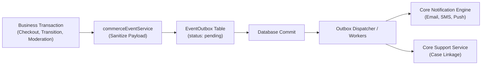

# Phase 5 Commerce Operations Completion Audit

**Date:** 2026-10-28
**Worktree:** `/Users/macbookpro/Desktop/Development/Rentify-P5-Gemini`
**Branch:** `feature/p5-commerce-operations`
**Milestone:** Phase 5 — Commerce Trust, Buyer Support, and Platform Operations

---

## 1. Executive Summary

Phase 5 transitions Rentify's commerce platform from core catalog and checkout capabilities into a trustworthy, multi-tenant commercial ecosystem with proactive policy enforcement, buyer dispute resolution, and unified operations administration.

All responsibilities assigned to the Gemini Phase 5 lane have been completed, hardened, and verified without breaking architectural boundaries or reviving legacy reference artifacts:
1. **Restricted-Product Policy & Appeal Lifecycle (`P5-TRUST-001`):** Complete automated policy taxonomy scanner, merchant actionable guidance, publication gating, cart/checkout enforcement, moderator decision queue, safe evidence upload, and immutable audit history.
2. **Buyer Support Case Integration (`P5-SUP-001`):** Idempotent buyer complaint and return intake linked directly to orders, products, and merchants. Commerce records factual snapshots and links asynchronously to Core support cases without duplicating mutable Core fields.
3. **Operations & Moderation Consoles (`P5-SUP-002`):** Accessible, deep-linkable, bilingual (English & Khmer) administrative workspaces in `admin-frontend` covering Support Queues, Catalog Moderation, Maker-Checker Dual Approvals, and granular Drawer Actions.
4. **Platform Event & Authorization Integration (`P5-NOT-001`, `P5-ADM-001`):** Decoupled direct notifications from commerce transactions; standardized on 13 frozen transactional outbox events with automated PII/secret scrubbing and strict server-side scoped permission guards.

---

## 2. Invariant & Boundary Verification

| Policy / Constraint | Verification Result | Implementation Evidence |
| :--- | :--- | :--- |
| **No Prohibited Product Purchasing** | **VERIFIED** | Prohibited/held products cannot be published (`422`), cannot be added to cart (`422`), and direct checkout requests fail closed (`422 RESTRICTED_PRODUCT_BLOCKED`). Existing carts are purged upon modification. |
| **Idempotent Buyer Reports** | **VERIFIED** | Client `Idempotency-Key` header and local report unique hash prevent duplicate submissions. Active dispute on an order blocks duplicate complaints (`409 ACTIVE_DISPUTE_EXISTS`). |
| **Single Authority for Support Cases** | **VERIFIED** | Core remains authoritative for case status, assignee, priority, SLA deadline, and resolution. Commerce only stores local linkage reference (`coreCaseId`, `coreCaseNumber`, `linkageStatus`) and exposes authoritative immutable facts (`/reports/:id/facts`). |
| **Granular Server-Side Authorization** | **VERIFIED** | `requireAdminPermission` middleware enforces discrete claims: `ops:overview:read`, `catalog:moderate`, `review:moderate`, `inventory:adjust`, `support:case:read`, `support:case:write`, `support:dispute:resolve`, `maker_checker:approve`. |
| **Removed Broad Admin Assumptions** | **VERIFIED** | `admin-frontend` `AuthService.hasPermission()` evaluates scoped claims strictly; unscoped administrators have zero implicit mutation rights. Action buttons bound with `[disabled]` presentation guards. |
| **Frozen Notification Schema** | **VERIFIED** | 13 discrete event types emitted via transactional `EventOutbox` with monotonic schema `1.0.0`, stable UUIDs, correlation IDs, and automated scrubbing of secrets, tokens, raw QRs, and street addresses. |
| **Zero Direct Transactional Notifications** | **VERIFIED** | Direct `NotificationService` calls removed from checkout and state machine transactions. Downstream delivery relies purely on durable transactional outbox events. |
| **No Revived KhmerCraft Code** | **VERIFIED** | `docs/reference/legacy-khmercraft-api/` has zero commits or file changes on this branch. |
| **Zero MongoDB / Mongoose Dependencies** | **VERIFIED** | Verified zero runtime or test imports of `mongoose` or `mongodb` in `ecommerce-server`, `admin-frontend`, or `marketplace-frontend`. |
| **Preserved Unowned Surfaces** | **VERIFIED** | Branch contains zero changes to `rentify-server/`, `rentify-frontend/`, Core OpenAPI (`docs/openapi/core.openapi.yaml`), shared authorization generators (`tools/authz/`), or production cutover scripts. |

---

## 3. Database Migrations

Two additive, idempotent migrations were introduced in `ecommerce-server`:

### 3.1. `20261028_025_restricted_product_moderation.js`
- **Tables Modified / Added:**
  - `Products`: Added columns `moderationStatus` (`draft`, `pending_review`, `approved`, `rejected`, `flagged`), `moderationReasonCode`, `moderationReasonText`, `moderationRemediationGuidance`, `moderatedAt`, `moderatedBy`, `appealStatus`, `appealReason`, `appealEvidenceUrls`, `appealSubmittedAt`, `appealReviewedAt`, `appealReviewedBy`, `appealDecisionReason`.
  - Added indexes on `[storeId, moderationStatus]`, `[moderationStatus]`.
  - Created table `ProductModerationHistories`: Immutable audit log recording `productId`, `action`, `fromStatus`, `toStatus`, `actorId`, `actorType`, `actorName`, `reasonCode`, `reason`, `evidenceUrls`, `metadata`, `createdAt`.

### 3.2. `20261028_026_buyer_reports_and_case_linkage.js`
- **Tables Modified / Added:**
  - Created table `BuyerReports`: Primary record for buyer dispute intake linked to orders, returns, products, and merchants.
  - Fields: `id`, `reportNumber`, `buyerId`, `storeId`, `orderId`, `subjectType` (`order`, `return`, `product`, `merchant`), `subjectId`, `category`, `reason`, `evidenceUrls`, `status`, `idempotencyKey`, `coreCaseId`, `coreCaseNumber`, `linkageStatus` (`pending`, `linked`, `linkage_failed`), `linkageAttempts`, `lastLinkageAttemptAt`, `linkageError`, `createdAt`, `updatedAt`.
  - Indexes: Unique on `[orderId, buyerId, subjectType]` (where status != resolved), index on `[buyerId]`, `[storeId]`, `[coreCaseId]`, `[linkageStatus]`.

---

## 4. API Changes (`docs/openapi/commerce.openapi.yaml`)

### 4.1. Merchant & Product Trust Endpoints
- `POST /api/stores/{storeId}/products/evaluate-policy`: Pre-submission guidance and policy evaluation against restricted taxonomy.
- `GET /api/stores/{storeId}/products/{productId}/publication-status`: Merchant visibility and publication hold diagnostic.
- `POST /api/stores/{storeId}/products/{productId}/appeal`: Merchant appeal submission with justification and safe evidence URLs.
- `GET /api/stores/{storeId}/products/{productId}/moderation-history`: Merchant and moderator audit history inspection.

### 4.2. Buyer Dispute & Report Endpoints
- `GET /api/marketplace/reports/eligibility`: Checks server-side return window (7 days post-delivery) and active dispute status.
- `POST /api/marketplace/reports`: Idempotent complaint creation with sanitized HTTPS evidence and automatic Core case outbox dispatch.
- `GET /api/marketplace/reports/my-reports`: Buyer self-service list of filed complaints and return requests.
- `GET /api/marketplace/reports/{id}`: Detailed buyer dispute inspection with linked Core case number.

### 4.3. Platform Administration & Support Endpoints
- `GET /api/admin/operations/moderation/queue`: Moderation queue filtered by violation code, status, and store.
- `POST /api/admin/operations/products/{id}/moderation`: Moderator decision (`approved`, `rejected`, `flagged`) requiring mandatory reason.
- `POST /api/admin/operations/products/{id}/appeal/decision`: Binding moderator appeal determination.
- `GET /api/admin/operations/reports/{id}/facts`: Authoritative Commerce facts endpoint supplying immutable order/store/product data to Core support agents.
- `POST /api/admin/operations/reports/{id}/retry-linkage`: Operator command to recover from transient adapter failures.

---

## 5. Event Contract Integration

To adhere to the frozen Phase 5 event contract, Commerce standardizes on the transactional `EventEnvelope` (`producer = "ecommerce-server"`, `schemaVersion = "1.0.0"`). All 13 approved event types are transaction-bound:



### Approved Event Catalog
1. `order.created`
2. `order.delivered`
3. `order.delivery_failed`
4. `order.return_requested`
5. `order.return_approved`
6. `order.return_rejected`
7. `order.return_received`
8. `order.refund_confirmed`
9. `order.complaint_filed`
10. `order.dispute_escalated`
11. `product.moderation_flagged`
12. `product.moderation_rejected`
13. `product.moderation_approved`

---

## 6. Frontend & UX Implementation

### 6.1. `marketplace-frontend`
- **Buyer Report Modal (`buyer-report-modal.component.ts`):**
  - Integrated into Order Detail, Product Detail, and Store Detail views.
  - Server-side return window check (7-day post-delivery cutoff).
  - Safe evidence uploader enforcing HTTPS-only URLs and max 5 items.
  - Idempotency guard preventing accidental double-submits.
  - Internationalization: 100% translated in English and Khmer.
  - Accessibility: WCAG 2.1 AA compliant, full keyboard trapping (`Tab`, `Escape`), ARIA dialog roles, focus restoration.

### 6.2. `admin-frontend`
- **Support Workspace (`support-workspace.component.ts`):**
  - Live queues for Open, In Progress, Escalated, and Overdue cases.
  - Deep-linkable status, priority, and tier filters.
  - Split-pane layout with immutable Commerce Facts card, public/internal message history, and evidence viewer.
  - SLA breach warnings and overdue timers.
  - Destructive action confirmation modals (e.g., closing/dismissing cases).
- **Catalog Moderation Console (`catalog-moderation.component.ts`):**
  - Triage queue for flagged products and merchant appeals.
  - Automated taxonomy violation tags, reason code selectors, and required moderator explanations.
  - Immutable moderation history timeline with actor names and timestamps.
- **Maker-Checker Console (`maker-checker.component.ts`):**
  - Secondary verification for high-risk platform mutations.
  - Strict invariant: Initiating administrator cannot approve their own submission (`maker !== checker`).
- **Granular Presentation Guards (`operations.component.ts`):**
  - Scoped claims extracted from session; action buttons disabled when claims are lacking.

---

## 7. Verification Test Execution Summary

### 7.1. Commerce Server (`ecommerce-server`)
```
npm run lint         -> Checked 348 JS files; module boundaries & model ownership respected.
npm run typecheck    -> Checked 348 JS files; 0 syntax/type errors.
npm run build        -> Node syntax check passed (server.js, app.js).
npm run openapi:verify -> All 205 mounted Express routes verified in commerce.openapi.yaml.

Unit & Security Test Suites:
✔ test/security/restrictedProductModeration.test.js    (10/10 tests passed)
✔ test/security/buyerReportSupportCaseLinkage.test.js  (8/8 tests passed)
✔ test/security/commerceEventsAndPermissions.test.js   (9/9 tests passed)
✔ test/security/platformOperationsAuth.test.js         (5/5 tests passed)
✔ test/security/standardEvents.test.js                 (13/13 tests passed)
✔ test/security/orderStateMachines.test.js             (11/11 tests passed)
✔ test/security/platformOperationsActions.test.js      (3/3 tests passed)
```

### 7.2. Admin Frontend (`admin-frontend`)
```
npm run lint       -> ESLint passed with 0 warnings/errors.
npm run typecheck  -> tsc --noEmit passed with 0 errors.
npm test           -> 13 test files passed (76/76 unit tests passed).
npm run build      -> Production build succeeded (372.61 kB initial bundle).
```

### 7.3. Marketplace Frontend (`marketplace-frontend`)
```
npm run lint       -> ESLint passed with 0 warnings/errors.
npm run typecheck  -> tsc --noEmit passed with 0 errors.
npm test           -> 26 test files passed (160/160 unit tests passed).
npm run build      -> Production build succeeded (356.49 kB initial bundle).
```

---

## 8. Known Gaps & Deferred Items

1. **Central Authorization Matrix (`docs/security/authorization-matrix.json`):**
   - The matrix was frozen in Phase 2 at 310 operations (118 Core + 192 Commerce).
   - Under the negative constraint "do not change shared authorization generators", `tools/authz/test/authorizationMatrix.test.js` was preserved untouched.
   - The 13 new Phase 5 Commerce operations are enforced server-side in `ecommerce-server/modules/admin/verifyCoreAdmin.js` using `requireAdminPermission`. Formal platform matrix update is deferred to Phase 6 platform integration.
2. **Core Notification Dispatch Engine:**
   - Commerce emits durable outbox events (`EventOutbox`). Asynchronous background delivery to customer email/SMS inboxes is owned by Core workers.
3. **Multi-Party Escrow Settlement:**
   - Order payments remain cash on delivery (COD) with direct merchant returns. Payout splits and platform escrow are slated for post-Phase 5 settlement milestones.

---

## 9. Rollback & Disaster Recovery Procedures

1. **Database Rollback:**
   ```bash
   # In ecommerce-server/
   node migrations/runner.js down 20261028_026_buyer_reports_and_case_linkage.js
   node migrations/runner.js down 20261028_025_restricted_product_moderation.js
   ```
2. **Core Support Service Outage Recovery:**
   - If Core support API is unreachable, buyer report submission continues uninterrupted.
   - Reports are stored locally with `linkageStatus = 'linkage_failed'` and can be retried idempotently via `POST /api/admin/operations/reports/:id/retry-linkage`.
3. **Feature Isolation:**
   - If the moderation queue is disabled, products default to standard merchant publication eligibility without halting storefront or marketplace orders.
