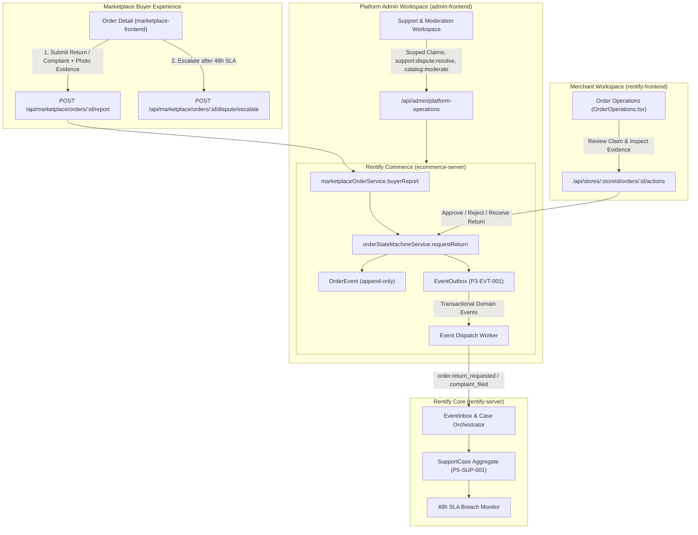
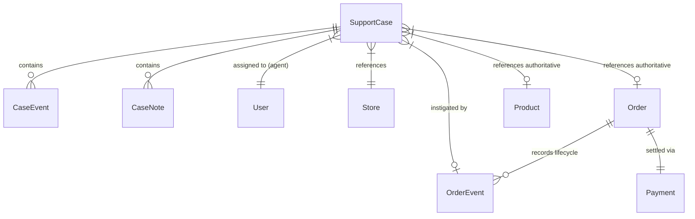
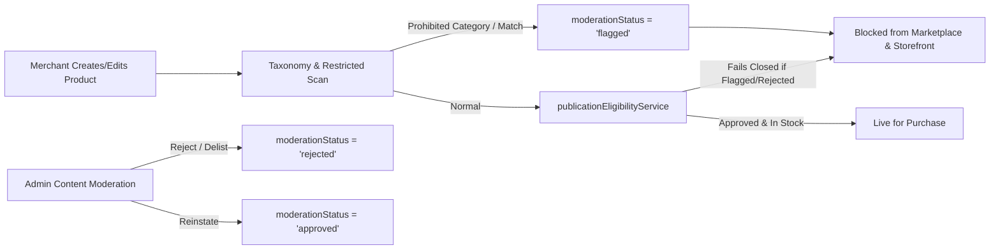
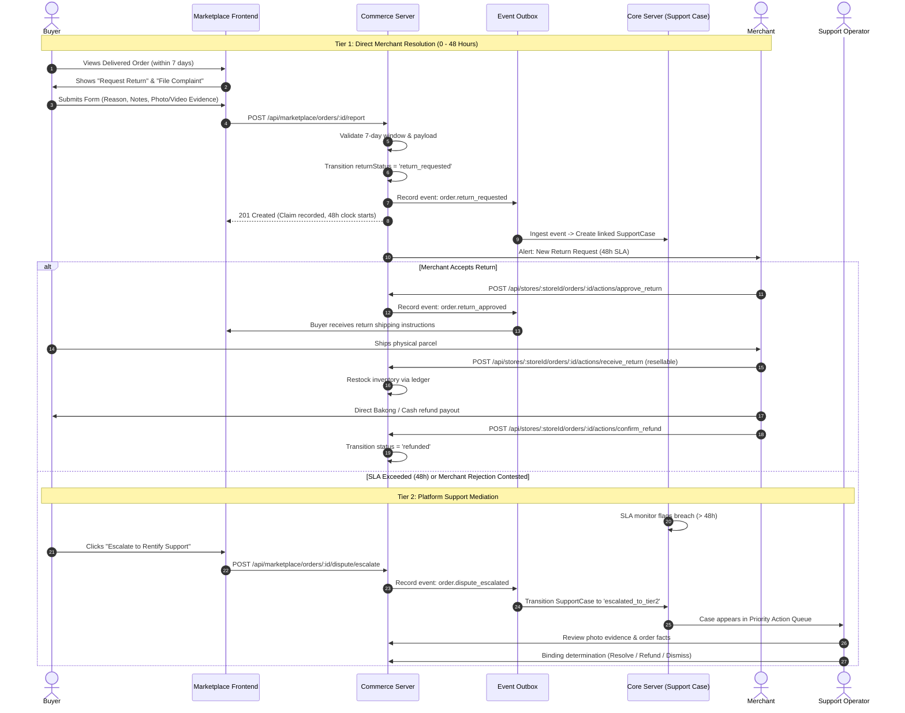
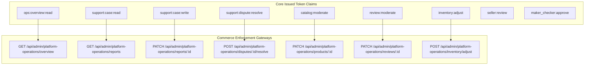

# Phase 5 Commerce Operations, Trust & Support UX Inventory

**Document ID:** P5-AUD-001<br/>
**Date:** 2026-10-28<br/>
**Workstream:** Lane C (Commerce) & Lane D/F (Commerce Operations, Trust & Administration)<br/>
**Worktree:** `/Users/macbookpro/Desktop/Development/Rentify-P5-Gemini`<br/>
**Branch:** `feature/p5-commerce-operations`<br/>
**Target Program:** Release 1 — Phase P5 ([`docs/ai-implementation-plan.md`](../ai-implementation-plan.md))<br/>
**Governing Documents & Baseline Audits:**
- [`docs/ai-implementation-plan.md#phase-p5`](../ai-implementation-plan.md) — Phase P5 Work Packages (`P5-TRUST-001`, `P5-SUP-001`, `P5-SUP-002`, `P5-ADM-001`, `P5-NOT-001`, `P5-SUB-001`, `P5-ANA-001`)
- [`docs/master-engineering-blueprint.md`](../master-engineering-blueprint.md) — Production Operations, State Machines & Trust Architecture
- [`docs/decisions/release-1-register.md`](../decisions/release-1-register.md) — Decisions `DEC-006` through `DEC-011`
- [`docs/audits/phase-3-verification.md`](phase-3-verification.md) — `P3-CAT-002` Eligibility, `P3-EVT-001` Event Outbox, `P3-ORD-001` Order State Machine, `P3-COD-001` State Machine
- [`docs/audits/phase-4-customer-journeys-map.md`](phase-4-customer-journeys-map.md) — Golden Journeys, Buyer Disputes & Tracking
- [`docs/audits/phase-4-merchant-experience.md`](phase-4-merchant-experience.md) — Merchant Order Operations & Boundaries

---

## 1. Executive Summary & Architectural Scope

Phase P5 of the AI Implementation Plan establishes the trust, support, and administrative operational capabilities required to protect buyers and small merchants after an order or account deviates from the happy path. 

> [!IMPORTANT]
> **Implementation Scope Boundary:**
> This audit addresses **Phase P5 of the AI Implementation Plan** (`docs/ai-implementation-plan.md`), which governs trust, support cases, moderation, notification outboxes, scoped admin permissions, and operational dashboards. It explicitly **does not** execute the separate cutover or legacy retirement steps from `docs/migration-plan.md` Phase 5 (KhmerCraft decommission).

### 1.1. Cross-Service Division of Labor: Core vs. Commerce

To preserve the multi-tenant architectural invariants defined in [`AGENTS.md`](file:///Users/macbookpro/Desktop/Development/Rentify-P5-Gemini/AGENTS.md) and [`docs/platform-architecture.md`](../platform-architecture.md):
- **Rentify Core (`rentify-server`)** is authoritative for user identity, store identity, seller KYC approval, storefront website deployments, subscriptions, and the **durable Support Case aggregate root (`SupportCase`)** with scoped RBAC session tokens.
- **Rentify Commerce (`ecommerce-server`)** is authoritative for catalog publication, restricted-product enforcement, inventory ledgers, carts, orders, COD payments, returns, complaints, and append-only order lifecycle audit events.
- **Marketplace Frontend (`marketplace-frontend`)** provides the buyer reporting, evidence submission, and dispute tracking experience.
- **Merchant Dashboard (`rentify-frontend/apps/core/merchant`)** provides the merchant order view and return/refund action interface.
- **Admin Console (`admin-frontend`)** provides platform operators with the support case workspace, catalog moderation queue, and seller trust consoles.



---

## 2. Existing vs. Missing Behavior Inventory

A line-by-line inspection of current codebase implementations reveals mature underlying domain engines paired with disconnected runtime surfaces, client-side stubs, and authorization gaps:

| Capability Domain | Existing Implementation (Code Verified) | Missing / Incomplete Runtime Behavior | Gap Severity |
| :--- | :--- | :--- | :--- |
| **P3-CAT-002 Publication Eligibility** | [`publicationEligibilityService.js`](file:///Users/macbookpro/Desktop/Development/Rentify-P5-Gemini/ecommerce-server/modules/catalog/publicationEligibilityService.js) evaluates 14 policy dimensions: Store status, seller approval, plan entitlement, primary category, product category, product status, SKU status, moderation status, channel flags, website status, stock, delivery policy, custom-domain boundary. Unit test coverage in [`channelPublicationEligibility.test.js`](file:///Users/macbookpro/Desktop/Development/Rentify-P5-Gemini/ecommerce-server/test/security/channelPublicationEligibility.test.js). | Coarse moderation states (`pending`, `flagged`, `rejected`) lack granular prohibited-goods violation taxonomy (DEC-006). Moderation reason codes do not store structured evidence or appeal links. | High |
| **P3-EVT-001 Event Outbox** | Database schema in `EventOutbox` ([`EventOutbox.js`](file:///Users/macbookpro/Desktop/Development/Rentify-P5-Gemini/ecommerce-server/models/EventOutbox.js)). Outbox recording, backoff retry scheduler, dead-letter classification, and replay audit in [`eventOutboxService.js`](file:///Users/macbookpro/Desktop/Development/Rentify-P5-Gemini/ecommerce-server/modules/events/eventOutboxService.js). | Order state transitions (`delivered`, `return_requested`, `return_approved`, `refund_confirmed`), buyer complaints, and catalog moderation actions **do not emit events to `EventOutbox`**. Events are trapped in local `OrderEvents`. | Critical |
| **Return State Machine** | [`orderStateMachineService.js`](file:///Users/macbookpro/Desktop/Development/Rentify-P5-Gemini/ecommerce-server/modules/orders/orderStateMachineService.js) has complete state machine: `NONE -> RETURN_REQUESTED -> RETURN_APPROVED/REJECTED -> RETURN_RECEIVED -> RETURN_COMPLETED`. Enforces DEC-008 7-day cutoff. `receiveReturn` supports restocking resellable items via `inventoryLedgerService`. Tested in [`returnsRestockingAdjustments.test.js`](file:///Users/macbookpro/Desktop/Development/Rentify-P5-Gemini/ecommerce-server/test/security/returnsRestockingAdjustments.test.js). | **Never invoked at runtime**. `marketplaceOrderService.buyerReport` creates an `OrderEvent` directly without transitioning `order.returnStatus`. Merchant API has no endpoints to approve, reject, or receive returns. | Critical |
| **Buyer Report Journey** | [`order-detail.component.ts`](file:///Users/macbookpro/Desktop/Development/Rentify-P5-Gemini/marketplace-frontend/src/app/pages/order-detail.component.ts) renders return/complaint forms. Enforces 7-day delivery check. Collects standard reasons and photo/video URL. Displays 48h SLA response deadline. | Evidence collection accepts only a raw external URL string; no secure file/photo upload. The "Escalate to Support" button (`escalateToSupport()`) is an in-memory client signal (`escalated.set(true)`); **no backend API call or case creation occurs**. | High |
| **Merchant Complaint & Return Experience** | [`OrderOperations.tsx`](file:///Users/macbookpro/Desktop/Development/Rentify-P5-Gemini/rentify-frontend/apps/core/merchant/src/pages/order-management/OrderOperations.tsx) displays order timeline and buyer report notices. Action modal handles `delivered`, `delivery_failed`, `retry_delivery`, `collect_cod`, `confirm_refund`. | Merchant **cannot** approve a return, reject a return, record physical parcel receipt (`receive_return`), inspect inspection items, or reply to complaints within the merchant UI. | High |
| **Admin Operations Console** | [`operations.component.ts`](file:///Users/macbookpro/Desktop/Development/Rentify-P5-Gemini/admin-frontend/src/app/pages/operations.component.ts) renders flat resource tables and basic drawer actions for products, reviews, and reports. Supports delisting products and triaging reports (`investigating`, `resolved`, `dismissed`). | No dedicated Support Case workspace. No SLA breach countdown. No two-tier escalation queue. No linked order/item/evidence inspector. No maker-checker dual approval for high-risk actions. | High |
| **Admin Authorization Consumption** | [`verifyCoreAdmin.js`](file:///Users/macbookpro/Desktop/Development/Rentify-P5-Gemini/ecommerce-server/modules/admin/verifyCoreAdmin.js) checks `entity.type === 'admin'` via Core `/api/auth/validate-token`. | Single broad monolithic admin check. Completely ignores scoped admin roles (`support_agent`, `catalog_moderator`, `seller_reviewer`, `finance_operator`, `platform_admin`) and permission claims. | Critical |
| **Commerce Notification Emission** | Notification service stub in Core (`rentify-server/src/modules/notifications/notificationService.js`). | Commerce has no notification emitter. Buyer claim filings, merchant responses, and SLA escalations fail to trigger in-app or outbound buyer/merchant alerts. | High |

---

## 3. Exact Implementation Surfaces

### 3.1. Backend Services (`ecommerce-server`)

| File Path | Role in Architecture | Required P5 Phase Changes |
| :--- | :--- | :--- |
| [`modules/catalog/publicationEligibilityService.js`](file:///Users/macbookpro/Desktop/Development/Rentify-P5-Gemini/ecommerce-server/modules/catalog/publicationEligibilityService.js) | Authoritative eligibility evaluator. | Incorporate restricted-product violation categories into `REASON_CODES` (`PRODUCT_PROHIBITED_GOODS`, `PRODUCT_COUNTERFEIT`, etc.). Surface structured remediation instructions. |
| `modules/catalog/restrictedProductService.js` *(new)* | Prohibited products domain engine. | Implement taxonomy validation, keyword pattern matching, prohibited category matrix, and appeal lifecycle state machine. |
| [`modules/admin/verifyCoreAdmin.js`](file:///Users/macbookpro/Desktop/Development/Rentify-P5-Gemini/ecommerce-server/modules/admin/verifyCoreAdmin.js) | Platform admin authentication gateway. | Replace coarse `entity.type === 'admin'` check with fine-grained claim validator supporting `req.claims` extracted from Core's signed/validated token payload. |
| [`modules/admin/platformOperationsRoutes.js`](file:///Users/macbookpro/Desktop/Development/Rentify-P5-Gemini/ecommerce-server/modules/admin/platformOperationsRoutes.js) | Admin HTTP operations routes. | Mount claim-enforcing middlewares (`requirePermission('catalog:moderate')`, `requirePermission('support:case:write')`, `requirePermission('inventory:adjust')`). |
| [`modules/admin/platformOperationsController.js`](file:///Users/macbookpro/Desktop/Development/Rentify-P5-Gemini/ecommerce-server/modules/admin/platformOperationsController.js) | Admin action handlers. | Support structured product moderation with reason codes; support dispute resolution with linkage to Core `SupportCaseId`; emit audit events. |
| [`modules/checkout/marketplaceOrderService.js`](file:///Users/macbookpro/Desktop/Development/Rentify-P5-Gemini/ecommerce-server/modules/checkout/marketplaceOrderService.js) | Buyer marketplace order operations. | Refactor `buyerReport` to invoke `orderStateMachineService.requestReturn` within database transaction; emit `order.return_requested` / `order.complaint_filed` outbox events. |
| [`modules/checkout/orderOperationsRoutes.js`](file:///Users/macbookpro/Desktop/Development/Rentify-P5-Gemini/ecommerce-server/modules/checkout/orderOperationsRoutes.js) | Storefront & merchant order actions. | Expose new merchant return actions: `POST /api/stores/:storeId/orders/:orderId/actions/approve_return`, `reject_return`, `receive_return`. |
| [`modules/orders/orderStateMachineService.js`](file:///Users/macbookpro/Desktop/Development/Rentify-P5-Gemini/ecommerce-server/modules/orders/orderStateMachineService.js) | State machine core. | Hook `eventOutboxService.recordEvent` into all legal transition transactions (`requestReturn`, `decideReturn`, `receiveReturn`, `completeReturn`, `confirmRefund`). |
| [`modules/events/eventOutboxService.js`](file:///Users/macbookpro/Desktop/Development/Rentify-P5-Gemini/ecommerce-server/modules/events/eventOutboxService.js) | Transactional outbox publisher. | Dispatch standard P5 domain events to message bus or webhook dispatch worker for Core consumption. |

### 3.2. Platform Administration Frontend (`admin-frontend`)

| File Path | Role in Architecture | Required P5 Phase Changes |
| :--- | :--- | :--- |
| [`src/app/pages/operations.component.ts`](file:///Users/macbookpro/Desktop/Development/Rentify-P5-Gemini/admin-frontend/src/app/pages/operations.component.ts) | Operational admin console. | Decompose into dedicated workspaces: Support Workspace, Catalog Moderation, Seller Review. Introduce claim-based action gating (`canModerateCatalog()`, `canResolveDisputes()`). |
| `src/app/pages/support-workspace/` *(new)* | Durable support case triage console. | Dedicated queue for open disputes, 48h SLA breach indicators, two-tier escalation actions, photo/evidence gallery, and audit timeline. |
| `src/app/pages/catalog-moderation/` *(new)* | Restricted-product review workspace. | Flagged listing queues, prohibited taxonomy check, evidence attachment, appeal review, and maker-checker approval for bulk takedowns. |
| [`src/app/services/platform-operations.service.ts`](file:///Users/macbookpro/Desktop/Development/Rentify-P5-Gemini/admin-frontend/src/app/services/platform-operations.service.ts) | Admin API client. | Add typed methods for support case management, dispute escalation, structured product takedowns, and claim-aware navigation. |

### 3.3. Marketplace Buyer Frontend (`marketplace-frontend`)

| File Path | Role in Architecture | Required P5 Phase Changes |
| :--- | :--- | :--- |
| [`src/app/pages/order-detail.component.ts`](file:///Users/macbookpro/Desktop/Development/Rentify-P5-Gemini/marketplace-frontend/src/app/pages/order-detail.component.ts) | Buyer order tracking and dispute UI. | Wire `escalateToSupport()` to live backend route `POST /api/marketplace/orders/:id/dispute/escalate`. Render returned dispute reference ID and support case status. Support multi-photo evidence upload. |
| [`src/app/core/rentify/rentify-marketplace.service.ts`](file:///Users/macbookpro/Desktop/Development/Rentify-P5-Gemini/marketplace-frontend/src/app/core/rentify/rentify-marketplace.service.ts) | Marketplace API client. | Add `escalateDispute(orderId, reason, idempotencyKey)` and evidence upload helper. |

### 3.4. Merchant Workspace (`rentify-frontend/apps/core/merchant`)

| File Path | Role in Architecture | Required P5 Phase Changes |
| :--- | :--- | :--- |
| [`src/pages/order-management/orderOperationsModel.ts`](file:///Users/macbookpro/Desktop/Development/Rentify-P5-Gemini/rentify-frontend/apps/core/merchant/src/pages/order-management/orderOperationsModel.ts) | Merchant order view models. | Expand `OrderActionCode` to include `approve_return`, `reject_return`, `receive_return`. Add dispute SLA status and evidence gallery types. |
| [`src/pages/order-management/orderOperationsApi.ts`](file:///Users/macbookpro/Desktop/Development/Rentify-P5-Gemini/rentify-frontend/apps/core/merchant/src/pages/order-management/orderOperationsApi.ts) | Merchant order API client. | Add action callers for return approval, rejection, and physical return receipt with inspection outcome (`resellable` vs `damaged`). |
| [`src/pages/order-management/OrderOperations.tsx`](file:///Users/macbookpro/Desktop/Development/Rentify-P5-Gemini/rentify-frontend/apps/core/merchant/src/pages/order-management/OrderOperations.tsx) | Merchant order management UI. | Add interactive return dispute banner, evidence review modal, 48-hour response countdown timer, and return handling forms. |

---

## 4. Commerce-to-Core Support-Case Linkage

### 4.1. The Linkage Model

Per [`master-engineering-blueprint.md#5.5`](../master-engineering-blueprint.md), **Core owns the durable `SupportCase` domain aggregate**, while **Commerce owns transaction facts** (`Order`, `Payment`, `OrderEvent`, `ProductReview`, `Product`). Cases must reference authoritative IDs rather than duplicating mutable facts.



### 4.2. Invariant Rules for Cross-Service Coordination

1. **Idempotent Case Instantiation:**
   When a buyer submits a complaint or return request in Commerce, Commerce emits `order.complaint_filed` or `order.return_requested` via `EventOutbox`. The Core event processor generates the `SupportCase` deterministically:
   $$\text{CaseId} = \text{UUIDv5}(\text{Namespace\_Case}, \text{orderId} + \text{"::"} + \text{eventKey})$$
   Replays of the same outbox event never create duplicate cases.
2. **Immutable Fact References:**
   A `SupportCase` stores pointers (`storeId`, `orderId`, `productId`, `buyerId`, `initiatingEventId`). If an order status changes in Commerce, the case queries the live Commerce read model rather than relying on stale cached snapshot properties.
3. **Causation Tracking:**
   When an administrator resolves a dispute or initiates a binding action from the Admin Console, the command sent to Commerce carries `X-Support-Case-ID: <caseId>`. Commerce records this `supportCaseId` inside the resulting `OrderEvent.details` for end-to-end auditability.
4. **SLA Breach Escalation:**
   Core runs an asynchronous SLA monitor checking for cases exceeding 48 business hours without merchant resolution. Upon breach, Core transitions `SupportCase.status = 'escalated_to_tier2'`, emits `support.sla_breached`, and flags the case in the Admin Support Workspace.

---

## 5. Restricted-Product Enforcement Points

In compliance with **DEC-006** and **DEC-007**, Rentify enforces a strict prohibited goods policy. The table below maps each enforcement point across the product lifecycle:



### 5.1. Prohibited Taxonomy & Violation Codes

| Prohibited Category | Machine Reason Code | Policy Reference | Fallback / Safe Action |
| :--- | :--- | :--- | :--- |
| **Weapons & Explosives** | `PROHIBITED_WEAPONS_EXPLOSIVES` | DEC-006 / Cambodian Arms Law | Immediate takedown; store flagged for review |
| **Illegal Narcotics & Paraphernalia** | `PROHIBITED_NARCOTICS` | DEC-006 / Anti-Drug Law | Immediate takedown; account referral to legal |
| **Counterfeit & Trademark Infringing** | `PROHIBITED_COUNTERFEIT` | DEC-006 / IP Protection Law | Delisted; trademark takedown notice issued |
| **Protected Wildlife & Endangered Flora** | `PROHIBITED_WILDLIFE_FLORA` | DEC-006 / Forestry & Wildlife Law | Immediate takedown; merchant warning strike |
| **Adult & Sexually Explicit Goods** | `PROHIBITED_ADULT_CONTENT` | DEC-006 / Digital Commerce Standards | Delisted from marketplace and hosted subdomains |
| **Toxic Chemicals & Hazardous Materials** | `PROHIBITED_HAZARDOUS_MATERIALS` | DEC-006 / Environmental Safety | Blocked; verification required |
| **Unlicensed Pharmaceuticals** | `PROHIBITED_UNLICENSED_MEDICINE` | DEC-006 / Ministry of Health Regs | Blocked unless pharmacy patent submitted |

### 5.2. Runtime Enforcement Checkpoints

1. **Catalog Mutation Barrier (`storeCatalogService.js`):**
   When a merchant adds or updates a product, the payload is checked against the prohibited keyword dictionary and restricted category list. If triggered, the product is saved with `moderationStatus: 'flagged'` and `marketplaceVisibility: false`.
2. **Centralized Visibility Engine (`publicationEligibilityService.js`):**
   `evaluateChannel()` evaluates `product.moderationStatus`. If `'pending'`, `'flagged'`, or `'rejected'`, it emits `PRODUCT_MODERATION_PENDING`, `PRODUCT_MODERATION_FLAGGED`, or `PRODUCT_MODERATION_REJECTED`. Both public browse and checkout queries fail closed (`purchasable: false`).
3. **Cart & Checkout Re-Evaluation Gate (`marketplaceCartService.js` & `marketplaceCheckoutGate.js`):**
   If an item was added to a cart prior to being flagged, the cart re-evaluation engine detects the updated moderation state and blocks checkout with an actionable explanation (`ITEM_MODERATION_HELD`), preventing purchase completion.
4. **Merchant Appeal Workflow:**
   Merchant catalog view displays the exact machine reason code, explanation, and an "Appeal Decision" trigger allowing the merchant to submit proof of legitimacy or licensing.

---

## 6. Buyer Complaint & Evidence Journey (Two-Tier Architecture)

To satisfy **DEC-008**, **DEC-009**, **DEC-010**, and **DEC-011**, the complaint and dispute journey follows a strict two-tier SLA-backed lifecycle:



### 6.1. Mandatory Evidence Standards (DEC-009)

When submitting a return request for damaged or defective items, the system mandates three evidence artifacts:
1. **Physical Product Damage:** Clear photo or video highlighting the defect, breakage, or discrepancy.
2. **External Packaging:** Photo showing the courier shipping box, polymailer, or parcel condition upon arrival.
3. **Courier Shipping Label:** Legible photo of the shipping waybill displaying tracking number, date, and courier details.

---

## 7. Admin Moderation & Support Workspace Screens

The current monolithic [`operations.component.ts`](file:///Users/macbookpro/Desktop/Development/Rentify-P5-Gemini/admin-frontend/src/app/pages/operations.component.ts) must be structured into three dedicated operational screens within `admin-frontend`:

### 7.1. Support Case Workspace (`/support/cases`)

- **Queue Views:**
  - *SLA Breached Queue:* Cases with 0 hours remaining (Tier 1 expired without merchant response).
  - *Urgent Queue:* Escalated disputes with pending buyer claims.
  - *Active Tier 1 Monitoring:* In-flight returns within the 48-hour merchant resolution window.
  - *Resolved / Closed Archive:* Historical cases with search and audit trail.
- **Case Detail Console (Three-Column Layout):**
  - *Column 1 (Metadata & Timeline):* Order facts, Store details, buyer identity, SLA clock, case priority, assigned support agent.
  - *Column 2 (Evidence & Communications):* Buyer return reason, uploaded damage photos (with lightbox zoom), courier label snapshot, merchant responses.
  - *Column 3 (Operational Actions):* Binding resolution controls, direct refund confirmation recorder, seller strike issuer, internal case notes.

### 7.2. Catalog Moderation Console (`/operations/catalog`)

- **Queue Views:**
  - *Flagged for Prohibited Content:* Automated keyword/taxonomy hits awaiting operator determination.
  - *Merchant Appeals:* Delisted items whose merchants submitted compliance documentation.
  - *Active Delistings:* Comprehensive registry of items currently held from public sale.
- **Moderation Detail Console:**
  - Side-by-side comparison of listing attributes (title, description, price, category, images) against the prohibited taxonomy.
  - Action buttons: `Approve Listing`, `Delist / Hold (Select Reason Code)`, `Permanent Takedown`.
  - Requires mandatory explanation field delivered safely to the merchant dashboard.

### 7.3. Seller Trust & Verification Console (`/operations/sellers`)

- **Seller Application Checklist (7-Point Audit per DEC-007):**
  1. Merchant phone verified via OTP.
  2. Merchant email verified.
  3. National ID or Patent Tax certificate reviewed.
  4. Physical store location / pickup address confirmed.
  5. Public customer support contact verified.
  6. Sample product listing reviewed for quality and taxonomy.
  7. Signed agreement to COD delivery, return, and refund standards.
- **Seller Standing & Strikes Ledger:**
  - Tracks merchant complaint rates, dispute frequency, and SLA breach count.
  - Strike threshold enforcement: 3 strikes trigger automatic suspension of marketplace selling privileges.

---

## 8. Frozen Permission Claims Consumed from Core

Commerce endpoints must replace the monolithic check (`entity.type === 'admin'`) with granular permission claims delivered in signed Core admin tokens and validated via `/api/auth/validate-token`:



### 8.1. Permission Claim Consumption Matrix

| Permission Claim | Scoped Role | Target Commerce Endpoint | Action Guarded |
| :--- | :--- | :--- | :--- |
| **`ops:overview:read`** | Support Agent, Reviewer, Admin | `GET /api/admin/platform-operations/overview` | Platform counts & queue sizing |
| **`support:case:read`** | Support Agent, Platform Admin | `GET /api/admin/platform-operations/reports` | View buyer complaints & return requests |
| **`support:case:write`** | Support Agent, Platform Admin | `PATCH /api/admin/platform-operations/reports/:id` | Update case notes, triage status |
| **`support:dispute:resolve`** | Senior Support Lead, Admin | `POST /api/admin/platform-operations/disputes/:id/resolve` | Issue binding dispute settlement |
| **`catalog:moderate`** | Catalog Moderator, Admin | `PATCH /api/admin/platform-operations/products/:id` | Flag, hold, reject, or reinstate product |
| **`review:moderate`** | Community Moderator, Admin | `PATCH /api/admin/platform-operations/reviews/:id` | Publish, hide, or flag buyer review |
| **`inventory:adjust`** | Operations Lead, Admin | `POST /api/admin/platform-operations/inventory/adjust` | Administrative stock correction |
| **`maker_checker:approve`**| Platform Admin (Secondary) | `POST /api/admin/platform-operations/actions/:id/approve` | Dual approval for high-risk actions |

---

## 9. Commerce Notification Events That Must Be Emitted

To satisfy **`P5-NOT-001`**, Commerce must emit transactional outbox events for all critical order, return, and trust transitions. Events adhere to the immutable [`EventEnvelope.js`](file:///Users/macbookpro/Desktop/Development/Rentify-P5-Gemini/ecommerce-server/modules/events/EventEnvelope.js) specification:

| Event Type (`eventType`) | Aggregate Type | Triggering Condition | Target Recipients |
| :--- | :--- | :--- | :--- |
| **`order.created`** | `Order` | Buyer places new order | Buyer (Confirmation), Merchant (New Order Alert) |
| **`order.delivered`** | `Order` | Courier delivers parcel | Buyer (Inspection reminder), Merchant |
| **`order.delivery_failed`** | `Order` | Delivery attempt unsuccessful | Buyer (Next steps), Merchant |
| **`order.return_requested`**| `Order` | Buyer submits return claim | Merchant (48h Action Required), Buyer (Receipt) |
| **`order.return_approved`** | `Order` | Merchant accepts return | Buyer (Shipping Instructions) |
| **`order.return_rejected`** | `Order` | Merchant declines return | Buyer (Reason & Escalation option) |
| **`order.return_received`** | `Order` | Merchant inspects parcel | Buyer (Payout pending) |
| **`order.refund_confirmed`**| `Order` | Merchant confirms direct refund | Buyer (Refund receipt), Core (Financial sync) |
| **`order.complaint_filed`** | `Order` | Buyer reports order problem | Merchant (Triage alert), Core (Support Case) |
| **`order.dispute_escalated`**| `Order` | 48h SLA breached / Escalated | Platform Support (Queue alert), Buyer, Merchant |
| **`product.moderation_flagged`**| `Product` | Prohibited content detected | Merchant (Takedown warning), Trust & Safety |
| **`product.moderation_rejected`**| `Product` | Moderator delists product | Merchant (Structured reason & appeal steps) |
| **`product.moderation_approved`**| `Product` | Moderator clears listing | Merchant (Publication confirmed) |

### 9.1. Sample Standardized Event Envelope

```json
{
  "eventId": "e6a2b841-8f5b-4357-9d74-297d02e08e1a",
  "eventType": "order.return_requested",
  "schemaVersion": "1.0.0",
  "aggregateType": "Order",
  "aggregateId": "ord_91823746",
  "aggregateVersion": 3,
  "occurredAt": "2026-10-28T14:15:00.000Z",
  "producer": "ecommerce-server",
  "correlationId": "corr_c8273649102",
  "causationId": "rpt-ret-ord_91823746-1730124900000",
  "storeId": "str_01h8x9p3q",
  "payload": {
    "orderId": "ord_91823746",
    "orderNumber": "ORD-20261028-0042",
    "buyerId": "usr_991827",
    "returnReason": "Damaged on arrival",
    "buyerNotes": "Screen shattered upon opening package.",
    "evidenceUrls": [
      "https://media.rentifymarket.com/stores/str_01h8x9p3q/evidence/photo1.jpg",
      "https://media.rentifymarket.com/stores/str_01h8x9p3q/evidence/waybill.jpg"
    ],
    "responseDeadline": "2026-10-30T14:15:00.000Z",
    "currency": "USD",
    "totalAmount": 4500
  }
}
```

---

## 10. Dependency & Policy Gaps

Before runtime implementation of Phase P5 begins, the following technical and policy dependencies must be resolved:

1. **Missing Merchant Return Action Routes:**
   Commerce has internal methods for `decideReturn` and `receiveReturn` in `orderStateMachineService.js`, but lacks public Express route handlers under `/api/stores/:storeId/orders/:orderId/actions/`. These must be exposed with Store-access authorization.
2. **Asynchronous SLA Escalation Worker:**
   While the 48-hour response deadline is calculated and displayed in the frontend, no backend background job exists to automatically escalate unresponsive cases. An automated cron worker or scheduled task is required.
3. **Secure Evidence Media Uploads:**
   The current frontend collects arbitrary HTTPS image URLs. A secure media upload endpoint (`POST /api/marketplace/evidence/upload`) that validates magic bytes, isolates evidence into private store buckets, and prevents hotlinking vulnerabilities must be formalized.
4. **Authorization Matrix Alignment:**
   The canonical `docs/security/authorization-matrix.json` currently classifies platform operations under the monolithic `platformAdmin` actor. The matrix must be updated to reflect the new scoped claims (`catalog:moderate`, `support:case:write`, etc.) before `npm run verify:authz` can pass.
5. **No Runtime Changes in this Audit:**
   In accordance with AI execution rules, this change introduces only this audit inventory document. Zero runtime application or server code has been altered.

---

## 11. Handoff & Implementation Readiness

- **Status:** Phase P5 Commerce Operations Audit Complete.
- **Verification:** Repository policy, secret scans, and git diff checks passing cleanly.
- **Next Step:** Stage, commit, push, and report readiness for human review before proceeding to runtime implementation.
