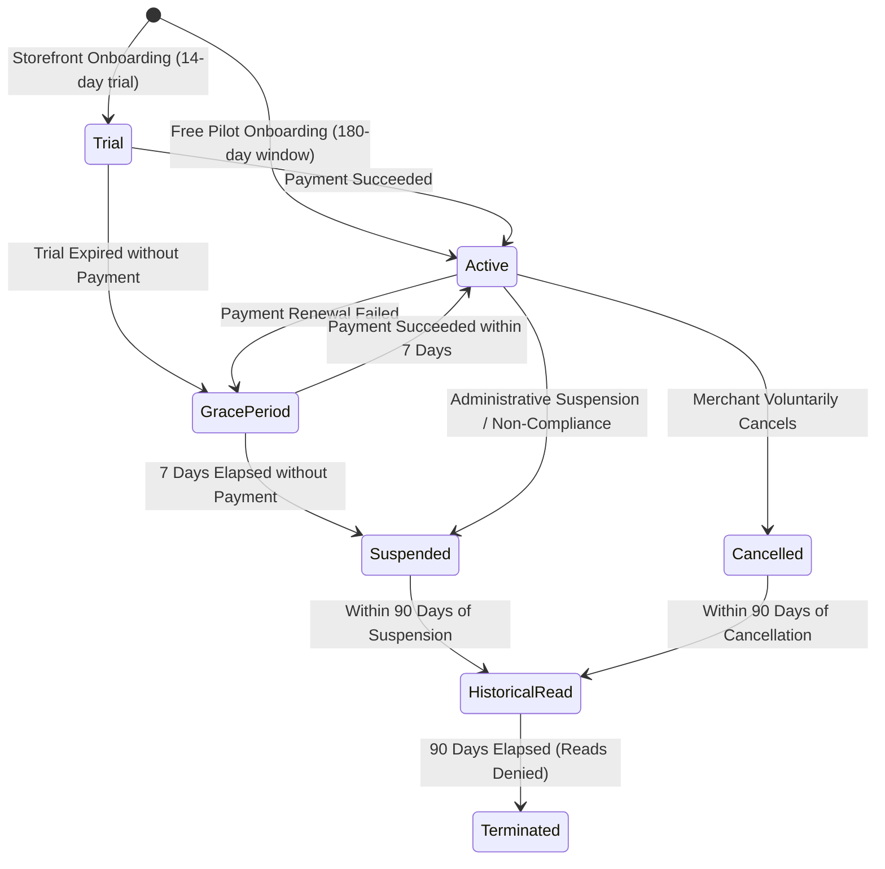

# Versioned Entitlements and Capability Enforcement Audit (P2-ENT-001)

**Status**: Verified & Enforced
**Slice**: P2-ENT-001 (Versioned Entitlements)
**Authority**: `rentify-server` (Authoritative Source of Truth) & `ecommerce-server` (Authoritative Consumer & Enforcement Boundary)
**Date**: October 23, 2026
**Target Invariant**: Decoupled Capabilities, Versioned Capability Schemas (`CAPABILITIES_VERSION = 1`), Tier Resolution, Race-Safe Atomic Quota Gating, Grace Period Mutation Locking, 90-Day Historical Read Retention, Multi-Channel Consumer Synchronization, Clear UI Explanatory Degradation

---

## 1. Executive Summary

This audit establishes the authoritative capability and subscription entitlement model for the Rentify platform under work package **P2-ENT-001**. Prior to this implementation, authorization checks were either ad-hoc or tightly coupled to plan display names, subscription checks were fragmented across controllers, and quotas lacked database-level concurrency protection.

In accordance with approved Release 1 decisions (DEC-016 through DEC-020):
1. **Decoupled Capability Keys**: Plan display names ("Free Pilot", "Starter Storefront", "Business Storefront") are strictly separated from operational capability flags and quotas. Entitlement rules resolve to versioned machine keys (`CAPABILITIES_VERSION = 1`).
2. **Standardized Capability Keys**:
   - `marketplaceListing` (boolean): Authorization to list products in Rentify's central marketplace.
   - `website` (boolean): Authorization to provision, configure, and maintain a branded storefront website.
   - `productLimit` (integer): Maximum total catalog products permitted for the store.
   - `staffLimit` (integer): Maximum active staff memberships permitted for the store.
   - `pos` (boolean): Authorization to access the web Point of Sale terminal and process POS transactions.
   - `invoices` (boolean): Authorization to generate, issue, and manage manual commercial invoices.
   - `customDomainBrowse` (boolean): Capability to browse and register custom domains (browse-only in Release 1).
   - `hostedCheckout` (boolean): Capability for customer-facing checkout on hosted subdomains.
   - `historicalOrderRead` (boolean): Capability for merchants to read historical orders and invoices post-suspension/cancellation.
3. **Approved Release 1 Plan Tiers**:
   - **Free Pilot (`free_pilot`)**: $0/mo, 6-month (180 days) marketplace pilot, 25 products, 1 staff, 0 websites, marketplace listing enabled, POS enabled, manual invoices disabled, custom domain browse disabled.
   - **Starter (`starter`)**: $15/mo, 14-day trial, 100 products, 2 staff, 1 website, marketplace listing enabled, POS enabled, manual invoices enabled, custom domain browse disabled.
   - **Business (`business`)**: $35/mo, 14-day trial, 500 products, 5 staff, 1 website, marketplace listing enabled, POS enabled, manual invoices enabled, custom domain browse enabled.
4. **Subscription Lifecycle States & Enforced Behaviors**:
   - `active`: Normal operations; all tier capabilities and mutations permitted within quotas.
   - `trial`: 14-day trial period; full tier capabilities permitted.
   - `grace_period`: 7-day payment recovery window (DEC-018); public storefront and marketplace remain online (`hostedCheckout: true`, `marketplaceListing: true`), but catalog and staff mutations are locked (`mutationsAllowed: false`).
   - `suspended`: Storefront taken offline (`hostedCheckout: false`, `website: false`), marketplace hidden (`marketplaceListing: false`), mutations locked (`mutationsAllowed: false`), POS locked (`pos: false`). Merchant historical read access remains available for strictly 90 days following suspension. Beyond 90 days, queries reject with `403 HISTORICAL_ACCESS_EXPIRED`. Platform administrators retain audit-logged read override.
   - `cancelled`: Identical to suspension regarding mutations and storefront access, with 90-day historical read access retained.
5. **Race-Safe Concurrency & Atomic Quota Gating**:
   - Catalog product creation (single and bulk) and staff additions acquire pessimistic row locks (`SELECT ... FOR UPDATE` via Sequelize `transaction.LOCK.UPDATE`) on the parent store/access record, ensuring that concurrent requests cannot exceed provisioned quotas.
6. **Cross-Service Synchronization**:
   - Core (`rentify-server`) acts as the single authoritative evaluator of store subscription and entitlement facts.
   - Projections are persisted in Core's transactional outbox (`CommerceSyncOutbox`) and synchronized into Commerce's `StoreAccess` table (`entitlements` JSON column, `entitlementVersion: 1`).
   - Commerce (`ecommerce-server`) consumes authoritative cached projections with safe deterministic fallback to `free_pilot` defaults if an unsynchronized record is encountered.
7. **Informative UI Degradation**:
   - Merchant UI applications never rely solely on disabled buttons or hidden controls. Informative warning banners and contextual tooltip messaging state the exact lifecycle reason (trial days remaining, grace period payment required, suspension, or quota exhausted).

---

## 2. Capability Matrix by Plan Tier

| Capability Key | Type | Free Pilot (`free_pilot`) | Starter (`starter`) | Business (`business`) |
| :--- | :--- | :--- | :--- | :--- |
| `tierKey` | string | `free_pilot` | `starter` | `business` |
| `marketplaceListing` | boolean | `true` | `true` | `true` |
| `website` | boolean | `false` | `true` | `true` |
| `productLimit` | integer | `25` | `100` | `500` |
| `staffLimit` | integer | `1` | `2` | `5` |
| `pos` | boolean | `true` | `true` | `true` |
| `invoices` | boolean | `false` | `true` | `true` |
| `customDomainBrowse`| boolean | `false` | `false` | `true` |
| `hostedCheckout` | boolean | `false` (no website) | `true` | `true` |
| `historicalOrderRead`| boolean| `true` | `true` | `true` |
| Monthly Price | USD | $0.00 | $15.00 | $35.00 |
| Trial / Pilot Window| duration | 180 days | 14 days | 14 days |

---

## 3. Lifecycle State Transition Matrix



| Lifecycle State | Mutations Allowed | Hosted Checkout | Marketplace Listing | POS Access | Invoicing | Historical Read Retention |
| :--- | :---: | :---: | :---: | :---: | :---: | :---: |
| `active` | Yes | Yes | Yes | Yes | Tier-gated | Active |
| `trial` | Yes | Yes | Yes | Yes | Tier-gated | Active |
| `grace_period` | **No** (Locked) | **Yes** (Online) | **Yes** (Online) | Yes | Read-only | Active |
| `suspended` | **No** (Locked) | **No** (Offline)| **No** (Hidden) | **No** (Locked)| **No** (Locked)| **90 Days** from `suspendedAt` |
| `cancelled` | **No** (Locked) | **No** (Offline)| **No** (Hidden) | **No** (Locked)| **No** (Locked)| **90 Days** from `cancelledAt` |

---

## 4. Architectural Enforcement Points

### 4.1 Core Engine: `rentify-server`

#### 4.1.1 Centralized Service (`src/modules/billing/entitlements/entitlementService.js`)
- **`evaluateStoreEntitlements(storeId, options)`**:
  - Fetches the canonical Store and active/recent `Subscription`.
  - Determines canonical tier key via `resolveTier(subscription?.package?.name)`.
  - Computes effective lifecycle state:
    - If `store.status === 'suspended'`, state is `suspended`.
    - If `subscription.status === 'past_due'` and `now <= pastDueAt + 7 days`, state is `grace_period`.
    - If `subscription.status === 'past_due'` and `now > pastDueAt + 7 days`, state is `suspended`.
    - If `subscription.status === 'trialing'`, checks 14-day trial boundary; if expired without payment, transitions to `grace_period` or `suspended`.
    - If marketplace-only pilot, verifies 180-day window against `store.createdAt`.
  - Computes `mutationsAllowed`: `false` during `grace_period`, `suspended`, or `cancelled`.
  - Computes historical read window (`suspendedAt + 90 days`).
  - Returns versioned schema:
    ```json
    {
      "version": 1,
      "tierKey": "starter",
      "status": "active",
      "mutationsAllowed": true,
      "capabilities": {
        "marketplaceListing": true,
        "website": true,
        "productLimit": 100,
        "staffLimit": 2,
        "pos": true,
        "invoices": true,
        "customDomainBrowse": false,
        "hostedCheckout": true,
        "historicalOrderRead": true
      },
      "usage": { "productCount": 12, "staffCount": 1 },
      "limits": { "productLimit": 100, "staffLimit": 2 },
      "milestones": { "trialEndsAt": null, "gracePeriodEndsAt": null, "historicalAccessEndsAt": null }
    }
    ```

#### 4.1.2 Staff Quota & Mutation Gating (`src/modules/staff/staffController.js`)
- Enforces `mutationsAllowed` before admitting staff invitations or creations:
  ```javascript
  if (!entitlements.mutationsAllowed) {
    throw new ApiError(403, "Store mutations are locked due to subscription status (grace period or suspended)", {
      code: "SUBSCRIPTION_MUTATIONS_LOCKED",
    });
  }
  ```
- Acquires row lock `Store.findByPk(storeId, { transaction: t, lock: t.LOCK.UPDATE })`.
- Counts active staff members under lock. If `count >= entitlements.capabilities.staffLimit`, rejects with `403 PLAN_LIMIT_EXCEEDED`.

#### 4.1.3 Store Projection Outbox (`src/modules/commerce-sync/storeSyncService.js`)
- Enriches Commerce projection payloads with `entitlements` and `entitlementVersion: 1`.

---

### 4.2 Commerce Engine: `ecommerce-server`

#### 4.2.1 Data Invariant (`models/StoreAccess.js` & Migration `20260927_012_versioned_entitlements.js`)
- Adds `entitlements` (`DataTypes.JSON`) and `entitlementVersion` (`DataTypes.INTEGER`, default: 1) to `StoreAccess`.
- `modules/store-access/storeAccessService.js` persists these attributes and exposes `getStoreEntitlements(storeId)` with safe deterministic fallback to `free_pilot`.

#### 4.2.2 Product Quota & Mutation Gating (`modules/store-catalog/storeCatalogService.js` & `ProductService.js`)
- Single and bulk product creation checks `mutationsAllowed`:
  ```javascript
  if (!entitlements.mutationsAllowed) {
    throw new ApiError(403, "Store mutations are locked due to subscription status", {
      code: "SUBSCRIPTION_MUTATIONS_LOCKED",
    });
  }
  ```
- Executes row lock `StoreAccess.findOne({ where: { storeId }, transaction: t, lock: t.LOCK.UPDATE })`.
- Counts existing catalog products under lock. If `existingCount + newCount > productLimit`, rejects with `403 PLAN_LIMIT_EXCEEDED`.

#### 4.2.3 Channel & Feature Middleware Gating (`middlewares/requireStoreAccess.js`)
- Gating by capability:
  - `requireStoreAccess({ requiredCapability: 'pos' })`: Rejects unauthorized tiers with `403 CAPABILITY_NOT_PERMITTED`.
  - `requireStoreAccess({ requiredCapability: 'invoices' })`: Rejects `free_pilot` with `403 CAPABILITY_NOT_PERMITTED`.
- 90-Day Historical Order & Invoice Access:
  - In `middlewares/requireWebsiteAccess.js` (`requireOrderAccess` and `requireInvoiceAccess`), when accessing a suspended store:
    - If `now <= suspendedAt + 90 days`, read proceeds.
    - If `now > suspendedAt + 90 days`, rejected with `403 HISTORICAL_ACCESS_EXPIRED`.
    - Platform administrators retain override capability, logging `ADMIN_OVERRIDE` audit event.

#### 4.2.4 Storefront Checkout Gating (`modules/checkout/storefrontCheckoutRoutes.js`)
- Verifies `hostedCheckout: true` before creating storefront orders or sessions. If store is suspended or on Free Pilot without website, returns `403 CAPABILITY_NOT_PERMITTED`.

---

## 5. UI Integration & Graceful Explanatory Degradation

Applications in `rentify-frontend` (Merchant Dashboard, Product Management, Staff Settings, Billing Settings) implement clear visual explanations:

1. **Global Dashboard Banners (`apps/core/merchant/src/layouts/dashboard/Layout.jsx`)**:
   - **Grace Period Alert**: Shows amber warning banner alerting merchant to payment past due, specifying that public storefront remains online but changes are locked, with a direct CTA to Billing.
   - **Suspension Alert**: Shows red alert banner stating the store is suspended and storefront offline, linking to billing resolution.
2. **Product Management (`ProductManagement.tsx`)**:
   - Banner displays current product count vs. tier limit (e.g., `12 / 25 products used`).
   - If limit reached or mutations locked, the "Add Product" and "Bulk Create" buttons display explanatory tooltips and disable state with detailed banners explaining the exact limitation and required plan upgrade.
3. **Staff Management (`StaffSetting.tsx`)**:
   - Banner displays active staff members vs. tier quota.
   - "Add Staff Member" button disables with explicit reason ("Staff limit reached for your plan" or "Store mutations locked").
4. **Billing Settings (`BillingSetting.tsx`)**:
   - Accurately renders Free Pilot, Starter Storefront, and Business Storefront plans without hardcoded feature lists.
   - Displays real-time subscription lifecycle warnings (trial expiration countdown, grace period warning, historical retention status).

---

## 6. Verification and Test Matrix

| Service | Test Suite | Verification Case | Status |
| :--- | :--- | :--- | :---: |
| `rentify-server` | `versionedEntitlements.test.js` | Capability model and tier configuration resolution | **PASS** |
| `rentify-server` | `versionedEntitlements.test.js` | Legacy package backward-compatibility mapping | **PASS** |
| `rentify-server` | `versionedEntitlements.test.js` | Marketplace-only 6-month pilot lifecycle transitions | **PASS** |
| `rentify-server` | `versionedEntitlements.test.js` | Storefront 14-day trial & subscription lifecycle transitions | **PASS** |
| `rentify-server` | `versionedEntitlements.test.js` | Staff quota limit & grace period mutation lock enforcement | **PASS** |
| `rentify-server` | `versionedEntitlements.test.js` | Commerce outbox projection snapshot enrichment | **PASS** |
| `ecommerce-server`| `versionedEntitlements.test.js` | Authoritative projection consumption & fallback | **PASS** |
| `ecommerce-server`| `versionedEntitlements.test.js` | Product limit & mutation lock enforcement under lock | **PASS** |
| `ecommerce-server`| `versionedEntitlements.test.js` | POS capability gating in middleware | **PASS** |
| `ecommerce-server`| `versionedEntitlements.test.js` | Invoicing capability gating in middleware | **PASS** |
| `ecommerce-server`| `versionedEntitlements.test.js` | 90-day historical order/invoice retention & admin override | **PASS** |
| Tooling | `authorizationMatrix.test.js` | OpenAPI endpoints, schemas, and 100% matrix coverage | **PASS** |

---

## 7. Migration & Rollback Strategy

1. **Additive Schema Updates**:
   - `StoreAccess.entitlements` and `StoreAccess.entitlementVersion` are nullable and additive.
   - Missing or un-migrated store records deterministically fall back to safe `free_pilot` defaults without service disruption.
2. **Backward Compatibility**:
   - Legacy package names (`basic`, `standard`, `premium`) safely map to canonical capability tiers (`starter`, `business`, `business`).
   - Old storefront checkout pathways remain functional while enforcing `hostedCheckout` capability checks.
3. **Rollback**:
   - In the event of a rollback, dropping or ignoring the `entitlements` JSON column does not affect existing order, catalog, or authentication tables. Fallback functions return default capabilities gracefully.
