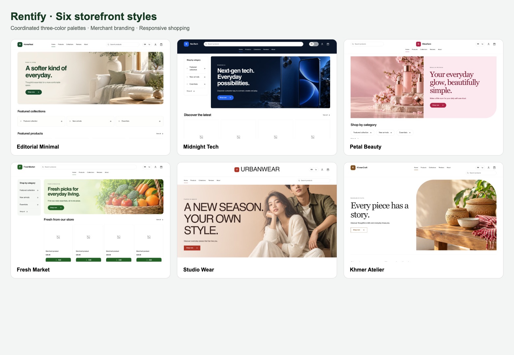

# Editorial Minimal storefront

Current: template ID 5 is a separate customer-facing template, registered by
`20261101_020_editorial_minimal_template.js`. Apply the Core migration before
selecting it through the existing template APIs. Existing websites retain their
selected template; no store is switched automatically.

The template uses the shared storefront search, product catalog, purchase,
cart, account and checkout routes and APIs. It preserves store availability
checks, hosted checkout boundaries and owner content controls. Marketplace
and merchant dashboard pages are unchanged.

Merchant content uses existing WebsiteContents labels: Logo / Store Logo,
Hero Headline, Hero Subtitle, Hero Image (multiple manually selectable banners),
Announcement, Contact Email, Phone Number, Locations, Social Media and
Copyright. Saved color palettes and Theme Configuration override template
defaults. Collections are live product categories; products and images come
from the canonical website catalog. No sample products or customer ratings
are inserted. The reviews section explicitly shows that store reviews are
unavailable: a public store-review API remains future work.

Layout supports desktop, tablet and mobile. Banners do not auto-rotate.

The store logo, navigation, search, account and cart are grouped in the top
header. The homepage starts directly with the large banner slider; store
identity and navigation are not repeated above the banner. Smaller screens
wrap search and navigation within that header.

## Industry styles and three-color customization

Current: the editorial family includes six selectable catalog entries:

| ID | Style | Intended business | Three brand colors |
| --- | --- | --- | --- |
| 5 | Editorial Minimal | Home and living | Forest green, warm ivory, white |
| 6 | Midnight Tech | Electronics | Bright blue, midnight navy, white |
| 7 | Petal Beauty | Beauty and wellness | Rose, pale pink, white |
| 8 | Fresh Market | Food and groceries | Leaf green, pale green, white |
| 9 | Studio Wear | Fashion and apparel | Terracotta, warm peach, white |
| 10 | Khmer Atelier | Handmade and crafts | Warm brown, natural linen, white |

IDs 6–10 are registered by `20261101_021_editorial_industry_styles.js`, in a
single transaction with conflict checks and stable IDs. Apply it after the
Editorial Minimal migration. These are six distinct page compositions with separate homepage components:
Home slider and tile grid; Electronics department sidebar and launch banner;
Beauty image-first split hero and ritual links; Grocery aisle menu and compact
catalog; Fashion full-width campaign and horizontal product edit; Crafts
journal introduction, portrait imagery and numbered collection index.
Headers and product arrangements also differ. The shopping components remain shared. All use
the existing shopping routes, tenant data, availability checks and checkout.
No products or reviews are seeded and no existing website is switched.

The Store design template gallery shows each style's banner and palette.
Onboarding shows banner previews and creates websites using the existing
selected-template API. Existing websites can preview the styles on desktop
and phone; applying a different template to an existing website remains
unavailable because Core has no template-switch endpoint. The existing
explanatory disabled action is retained.

Store design also has a Brand colors tab. Merchants can choose any of the
six three-color combinations or adjust accent, supporting color and background
individually, then save through the existing owner-authorized theme API.
Saving merges those colors into Theme Configuration, preserving typography
and other theme settings. The live store changes and the preview reloads
only after a successful save. Template preview alone does not save changes.
Merchant-saved theme settings continue to override template defaults.

The six original banner photographs were generated with the built-in
`image_gen` tool and optimized to WebP. They live in
`rentify-frontend/libs/storefront/src/assets/editorial/`; the exact prompts
are retained in `prompts.json` beside them. A merchant's Hero Image content
replaces the starter artwork; multiple merchant banners keep manual slider
controls. Headline and subtitle content also override style defaults.

The onboarding and merchant template pickers now use rendered layout thumbnails
from `assets/editorial/previews`, rather than only the banner photos.

The Branding tab also uploads a merchant logo or replaces the main banner
through the existing website image endpoint (`isLogo=true` or `type=cover`).
The endpoint creates missing content rows for a new website. Image uploads
refresh the website data and preview after success. The existing storefront
Hero editor remains available for headline, subtitle and multiple banners.
