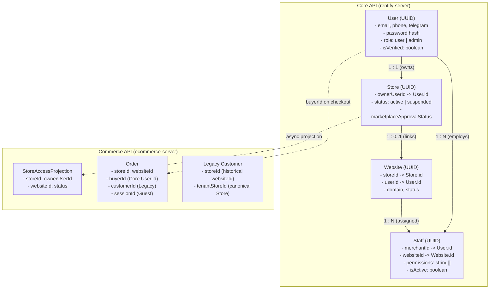
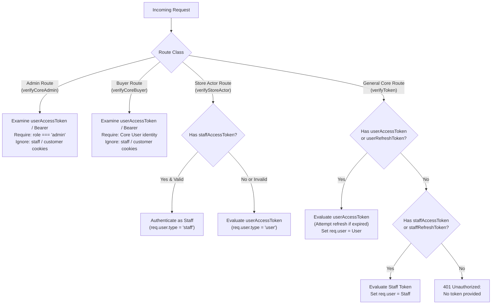

# Rentify Identity and Authoritative Subject Model

**Status:** Authoritative Specification, 2026-10-22  
**Work Package:** `P2-ID-001`  
**Prerequisites:** `P1-QA-001`  
**Companion Documents:** [`platform-architecture.md`](platform-architecture.md), [`current-rentify-architecture.md`](current-rentify-architecture.md), [`decisions/release-1-register.md`](decisions/release-1-register.md), [`adr/0002-unified-buyer-identity.md`](adr/0002-unified-buyer-identity.md), [`../rentify-server/docs/adr/0001-identity-and-cross-domain-sso.md`](../rentify-server/docs/adr/0001-identity-and-cross-domain-sso.md)

---

## 1. Executive Summary and Principles

Rentify unites merchant storefronts, point of sale (POS), invoicing, staff management, and a shared consumer marketplace under one unified platform. To prevent account hijacking, cross-store data leakage, and confused-deputy privilege escalation, all platform interactions adhere to these foundational identity principles:

1. **One Authoritative Identity Authority (Core):**
   `rentify-server` (Core) is the single authoritative system of record for person identity (`User`), staff memberships (`Staff`), and Store ownership (`Store`). Commerce (`ecommerce-server`) does not issue or own workforce credentials or central buyer accounts.
2. **Identity $\neq$ Authorization:**
   Authentication proves *who* the caller is (the subject). Authorization determines *what* the caller may do within an explicit tenant (`Store`) or channel (`Website`) context.
3. **No Identity Selection from Untrusted Body or Query Parameters:**
   Identity (`userId`, `buyerId`, `merchantId`, `actorId`) must strictly derive from cryptographically verified tokens or sessions mounted by authenticated middleware. Body and query parameters cannot select or override the acting subject.
4. **Separation of Store and Website Context:**
   The `Store` is the primary commercial and legal tenant. `Website` is an optional sales channel linked to at most one Store. Access to a Store and access to a Website are independently validated.
5. **Deterministic Precedence and Conflicting-Credential Rejection:**
   When multiple tokens or credentials exist in a request, route-specific middleware applies unambiguous precedence rules. Conflicting credentials (e.g. Bearer token and Cookie claiming different subjects) are rejected with `401 Unauthorized`.
6. **No Auto-Merging by Email Text:**
   Matching email text alone never merges or links two identity records across services or storefronts. Verification and explicit linking flows are mandatory.

---

## 2. Authoritative Subject Model

### 2.1 Core Identity Types and Systems of Record

| Identity Role | Authoritative Model & Database | Primary Identifier | Authentication Boundary | Session Type | Authority Service |
| :--- | :--- | :--- | :--- | :--- | :--- |
| **Merchant Owner** | `User` in `rentify_core` | `User.id` (UUIDv4) | Central Rentify Auth | `userAccessToken` + `userRefreshToken` | `rentify-server` |
| **Platform Administrator** | `User` (where `role='admin'`) in `rentify_core` | `User.id` (UUIDv4) | Central Rentify Auth | `userAccessToken` + `userRefreshToken` (requires `admin` claim) | `rentify-server` |
| **Central Marketplace Buyer** | `User` (where `role='user'`) in `rentify_core` | `User.id` (UUIDv4) | Central Rentify Auth | `userAccessToken` + `userRefreshToken` (`buyerId = req.user.id`) | `rentify-server` |
| **Store Staff** | `Staff` in `rentify_core` | `Staff.id` (UUIDv4) | Central Staff Auth | `staffAccessToken` + `staffRefreshToken` | `rentify-server` |
| **Legacy Storefront Customer** | `Customer` in `rentify_ecommerce` | `Customer.id` (UUIDv4) | Storefront Host Only | `customerAccessToken` + `customerRefreshToken` (host-only) | `ecommerce-server` |
| **Guest Shopper** | Ephemeral browser session | `sessionId` (String) | Storefront / Marketplace | `sessionId` cookie | `ecommerce-server` |

---

### 2.2 Subject Attributes and Assurance Levels



#### Detailed Subject Attributes

1. **`User` (Core Identity Authority):**
   - **`id`** (UUIDv4): Unique, permanent identifier across the entire platform.
   - **`role`** (`user` | `admin`): Platform role. `admin` grants platform-wide administrative privileges subject to explicit admin route guards. `user` covers merchants, staff users, and buyers.
   - **`isVerified`** (boolean): True once email or Telegram OTP verification has been completed. Unverified users cannot check out or create published stores.
   - **`failedAttempts` & `lockUntil`**: Failed login throttling. 5 consecutive failed password attempts locks the account for 15 minutes.
   - **`refreshToken` & `refreshTokenExpires`**: Bcrypt hash of active 30-day refresh token. Expired or revoked on logout / password reset.

2. **`Staff` (Delegated Store Operator):**
   - **`id`** (UUIDv4): Independent UUID identifying the staff record.
   - **`merchantId`** (UUIDv4): References `User.id` of the employing store owner.
   - **`websiteId`** (UUIDv4): References `Website.id` where the staff member is assigned.
   - **`permissions`** (JSON Array): Allowed operational scopes: `manage_products`, `manage_orders`, `manage_invoices`, `manage_pos`, `manage_analytics`, `manage_settings`, `manage_staff`.
   - **`isActive`** (boolean): Kill-switch. Inactive staff cannot authenticate or refresh tokens.

3. **`Customer` (Legacy Storefront Account):**
   - **`id`** (UUIDv4): Commerce-local customer identifier.
   - **`storeId`** (UUIDv4): Historical field containing `platformWebsiteId` (Website ID).
   - **`tenantStoreId`** (UUIDv4, nullable): Canonical Store ID backfill.
   - **Boundary Invariant:** Never trusted as a central Rentify buyer or merchant identity. Scoped strictly to that individual storefront host.

---

## 3. Multi-Role Subjects and Persona Separation

A single human being in the Rentify ecosystem may hold multiple legitimate roles simultaneously:

```text
               +-------------------------------------------+
               |                 Human Person              |
               |             (Single Natural Person)       |
               +-------------------------------------------+
                                     |
                                     v
               +-------------------------------------------+
               |            Core User (User.id)            |
               |            Authentic Identity             |
               +-------------------------------------------+
                     /               |               \
                    /                |                \
                   v                 v                 v
          [Merchant Owner]      [Central Buyer]   [Store Staff Member]
           Store A: Owner       Store B: Shopper    Store C: Staff Member
           (ownerUserId =       (buyerId =          (Staff record linked
            User.id)             User.id)            to User or email)
```

### 3.1 One Person as Merchant and Buyer
- **Mechanism:** The person registers once in Core Auth. Their authoritative identity is `User.id`.
- **Merchant Persona:** When acting as a merchant, request authorization guards (`requireStoreAccess`, `requireWebsiteOwner`) assert that `store.ownerUserId === req.user.id`.
- **Buyer Persona:** When shopping on the shared marketplace or any hosted storefront, the buyer checkout and order services record `buyerId: req.user.id`.
- **Isolation Guarantee:** The merchant dashboard only exposes data for stores owned by `req.user.id`. Buyer order histories query `WHERE buyerId = req.user.id`. A merchant cannot view buyer orders for stores they do not own, and cannot view other buyers' orders on their own store except through merchant order management.

### 3.2 One Person as Owner of Store A and Staff of Store B
- **Mechanism:**
  - Owner role for Store A is anchored in `Store.ownerUserId = UserA.id`.
  - Staff role for Store B is anchored in a `Staff` record (`Staff.id`, `merchantId = UserB.id`, `websiteId = WebsiteB.id`).
- **Session Separation:**
  - Merchant owner actions use `userAccessToken` (JWT payload: `{ id: UserA.id, role: 'user' }`).
  - Staff actions use `staffAccessToken` (JWT payload: `{ id: StaffB.id }`).
- **Authorization Guarantees:**
  - When accessing Store A, `requireStoreAccess` verifies `store.ownerUserId === req.user.id`.
  - When accessing Store B via staff credentials, `requireStoreAccess` / `verifyStoreActor` verifies `req.user.role === 'staff' && req.user.merchantId === store.ownerUserId && req.user.permissions.includes(...)`.
  - A staff member cannot escalate privileges to Store A owner using their staff token, and cannot administer Store B using their Store A owner token without explicit staff authorization.

---

## 4. Session Lifecycle, Tokens, and Cookie Precedence

### 4.1 Token Types and Lifecycles

| Token | Scope / Transport | Expiry | Rotation & Revocation |
| :--- | :--- | :--- | :--- |
| **`userAccessToken`** | Cookie (`HttpOnly; Secure; SameSite=Lax`) or `Bearer` header | 15 minutes | Stateless JWT. Re-issued via refresh token. |
| **`userRefreshToken`** | Cookie (`HttpOnly; Secure; SameSite=Lax`) | 30 days | Stored as bcrypt hash. Rotates on every refresh. Revoked on logout, password reset, or account lock. Parallel-refresh grace period (10s) supported. |
| **`staffAccessToken`** | Cookie (`HttpOnly; Secure; SameSite=Lax`) | 15 minutes | Stateless JWT containing `{ id: staff.id }`. |
| **`staffRefreshToken`** | Cookie (`HttpOnly; Secure; SameSite=Lax`) | 30 days | Stored as bcrypt hash on `Staff`. Rotates on refresh; revoked on logout. |
| **`customerAccessToken`** | Host-only Cookie (`HttpOnly; Secure; SameSite=Lax`) | 15 minutes | Local to storefront host. `COOKIE_DOMAIN` explicitly stripped. |
| **`customerRefreshToken`** | Host-only Cookie (`HttpOnly; Secure; SameSite=Lax`) | 7 days | Stored as bcrypt hash on `Customer`. |
| **Password Reset Token** | One-time URL token | 1 hour | Stored as SHA-256 hash. Single-use. Revokes active refresh tokens upon completion. |
| **One-Time Password (OTP)** | Email / Telegram code | 10 minutes | 6-digit numeric code. Max 5 failed attempts before temporary lockout. |
| **Staff Invitation Token** | Email / Telegram acceptance link | 7 days | Cryptographically secure random 32-byte hex. Cleared upon activation. |

---

### 4.2 Deterministic Cookie and Token Precedence Rules

When incoming HTTP requests carry multiple credentials, middleware resolves identity using this strict hierarchy:



#### Conflicting Credentials Policy:
1. **Bearer Header vs Cookie Conflict:**
   If a request provides BOTH `Authorization: Bearer <token_A>` AND `Cookie: userAccessToken=<token_B>`:
   - If both decode to valid subjects and `token_A.id !== token_B.id`, the request MUST be rejected with `401 Unauthorized: Conflicting credentials provided`.
   - Silent fallback to either token is prohibited to prevent confused-deputy attacks.
2. **Expired User Token with Coexisting Staff Cookie:**
   If `userAccessToken` is present but invalid/expired, and `userRefreshToken` is invalid or missing, Core `verifyToken` clears user cookies and rejects with `401 Unauthorized: Invalid token`. It does NOT silently fall back to `staffAccessToken`.
3. **Buyer Route Cookie Isolation:**
   Marketplace buyer endpoints (`verifyCoreBuyer`) ignore legacy `customerAccessToken` and `staffAccessToken` cookies entirely. A legacy storefront customer cookie cannot be used to execute marketplace purchases or inspect other buyers' records.

---

## 5. Security Vulnerability Mitigations and Hardening

During this audit, five immediate identity-confusion and authorization vulnerabilities were identified and resolved with narrow, backwards-compatible fixes:

### 5.1 Cache Eviction Identity Injection (`websiteController.clearCache`)
- **Vulnerability:** `POST /api/websites/cache/clear` accepted `{ userId, websiteId, domain }` in the request body. Any authenticated user could supply another user's `userId` or another merchant's `websiteId` and evict their cache.
- **Fix:** Enforced authorization:
  - If `userId` is provided: caller must be `admin` or match `req.user.id`.
  - If `websiteId` is provided: caller must be `admin` or own the website (`website.userId === req.user.id`).
  - If `domain` is provided: caller must be `admin` or own the website associated with that domain.
  - Non-owners receive `403 Forbidden`.

### 5.2 Staff Invitation Merchant Impersonation (`staffController.sendStaffInvitation`)
- **Vulnerability:** `POST /api/staff/invite` destructured `{ merchantId }` directly from `req.body`. An authenticated user could supply a victim merchant's `merchantId` and attach a malicious staff member to the victim's account.
- **Fix:** If caller is not an `admin`, `merchantId` is strictly bound to `req.user.id`. If a non-admin request supplies a conflicting `req.body.merchantId !== req.user.id`, the request is rejected with `403 Forbidden: Cannot invite staff for another merchant`.

### 5.3 Storefront Order Retrieval Isolation (`MyOrderDetailsStrategy`, `MyOrdersStrategy`, `MyOrderPaymentStrategy`)
- **Vulnerability:** When a request lacked a `user.id` or `user.sessionId`, Sequelize constructed queries with `sessionId: undefined`. Sequelize strips undefined keys from WHERE clauses, causing the query to execute without session or user scoping (e.g. `WHERE id = :orderId`), allowing arbitrary order and shipping detail leakage.
- **Fix:**
  - Added explicit check: if `user.type === 'customer' && user.id`, filter by `where.userId = user.id`.
  - If `user.type === 'user' && user.id` (Core buyer), filter by `where.buyerId = user.id`.
  - If `user.sessionId`, filter by `where.sessionId = user.sessionId`.
  - If none of these identifiers exist, immediately reject with `401 Unauthorized: Identification required`. Queries are never executed without tenant/buyer scoping.

### 5.4 Conflicting Header and Cookie Rejection (`rentify-server` & `ecommerce-server`)
- **Vulnerability:** If an API client passed an `Authorization: Bearer` token for Subject A, but the browser context held a `userAccessToken` cookie for Subject B, the server silently favored one credential without verifying alignment, risking unintentional action execution under the wrong account.
- **Fix:** In `verifyToken` and `createVerifyCoreBuyer`, if both bearer and cookie tokens are present and decode to different subjects, reject immediately with `401 Unauthorized: Conflicting credentials provided`.

### 5.5 Contact-to-Identity Separation
- **Guarantee:** An order's shipping contact email or POS customer email is strictly transactional snapshot data. It is never used to infer, merge, or grant access to an existing `Customer` or Core `User` account without verified credentials.

---

## 6. Migration and Legacy Compatibility Boundaries

1. **Legacy KhmerCraft Reference Code:**
   The archived codebase in `docs/reference/legacy-khmercraft-api/` remains non-executable reference material only. No MongoDB drivers, legacy customer schemas, or unhashed password mechanisms are introduced to Rentify.
2. **Storefront Customer Accounts:**
   Storefront `Customer` records in Commerce remain host-only and isolated per website until the unified buyer account migration (Phase P4 / ADR 0002).
3. **Canonical Store Key Transition:**
   Where legacy models reference `storeId` as a `websiteId`, the canonical `tenantStoreId` is populated to bridge towards pure Store-first tenancy (`P2-AUTHZ-002`).

---

## 7. Audit and Verification Checklist

| Requirement | Code Location | Verification Evidence |
| :--- | :--- | :--- |
| **Merchant-only subject** | `rentify-server/src/middlewares/authorization.js` | `authorization.test.js`, `identitySubjectModel.test.js` |
| **Buyer-only subject** | `ecommerce-server/middlewares/authMiddleware.js` | `marketplaceBuyerAuth.test.js`, `identitySubjectModel.test.js` |
| **Staff-only subject** | `rentify-server/src/modules/staff/` | `verifyStaffToken.js`, `identitySubjectModel.test.js` |
| **Administrator subject** | `rentify-server/src/middlewares/authorization.js` | `adminTemplates.test.js`, `verifyCoreAdmin.js` |
| **Merchant + Buyer dual role** | `ecommerce-server/modules/checkout/` | `identitySubjectModel.test.js` |
| **Owner + Staff dual role** | `ecommerce-server/middlewares/requireStoreAccess.js` | `storeAccess.test.js`, `identitySubjectModel.test.js` |
| **Conflicting credentials** | `rentify-server/src/middlewares/auth.js` | `identitySubjectModel.test.js` |
| **Session rotation & revocation** | `rentify-server/src/modules/auth/authService.js` | `sessionLifecycle.test.js`, `refreshTokenGrace.test.js` |
| **Untrusted body identity rejection**| `websiteController.js`, `staffController.js` | `identitySubjectModel.test.js` |
| **Cross-store identity isolation** | `MyOrderDetailsStrategy.js`, `MyOrdersStrategy.js` | `identitySubjectModel.test.js` |
