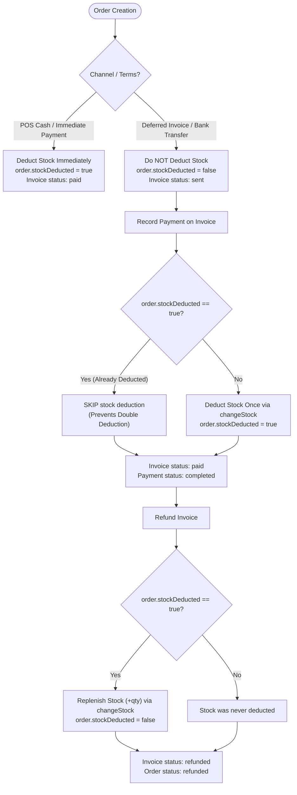

# Invoice, Quote, and Payment Reconciliation Policy (P4-INV-001)

## 1. Domain Separation

Rentify strictly distinguishes between two completely separate invoicing domains:

| Attribute | Merchant Commercial Invoices | Platform Subscription Invoices |
| :--- | :--- | :--- |
| **Authority** | `ecommerce-server` | `rentify-server` |
| **Domain Tag** | `merchant_commerce` | `platform_subscription` |
| **Participants** | Merchant Store $\leftrightarrow$ Buyer / Customer | Rentify Platform $\leftrightarrow$ Merchant |
| **Subject** | Physical products, catalog items, variants, shipping, tax | Platform subscription plans, hosting tiers, add-ons |
| **Stock Impact** | Authoritatively decrements/restores catalog inventory via `sharedStockService.changeStock` | **Zero** inventory interaction |
| **Primary Model** | `ecommerce-server/models/Invoice.js` | `rentify-server/src/models/Subscription.js` |

> [!IMPORTANT]
> A buyer commercial invoice in `ecommerce-server` must never interact with platform subscription billing tables, and platform billing events in `rentify-server` must never decrement merchant catalog stock.

---

## 2. Semantic Distinctions: Quote vs. Invoice vs. Order

### Quote (`isQuote: true`, prefix `QTE-`)
- **Nature**: Non-binding commercial estimate given to a prospective buyer.
- **Stock Effect**: **NONE**. Quotes produce **zero stock deduction** and **zero stock reservation**.
- **State**: Initial status is `draft` with an `expiresAt` deadline.
- **Conversion**: Can be converted into a binding commercial Invoice via `/stores/:storeId/quotes/convert`.

### Order (`ecommerce-server/models/Order.js`, prefix `ORD-`)
- **Nature**: Authoritative fulfillment record and inventory ledger.
- **Inventory Tracking**: Records the boolean flag `order.stockDeducted`.
- **Relationship**: The canonical parent of line items (`OrderItems`), shipping facts (`ShippingDetail`), and payment records (`Payment`).

### Invoice (`ecommerce-server/models/Invoice.js`, prefix `INV-`)
- **Nature**: Commercial payment obligation and financial snapshot linked to an `Order`.
- **Data Minimization**: Invoices do not duplicate volatile catalog metadata; they maintain immutable snapshots (`buildInvoiceSnapshot`) derived from the canonical `Order` and `Payment`.

---

## 3. Authoritative Stock Lifecycle & Non-Double-Deduction Invariant

Omnichannel commerce spans physical counter POS sales, online storefront checkouts, and deferred B2B/manual invoices. To guarantee that stock is never deducted twice or silently lost, the following rules are enforced:

### The Non-Double-Deduction Invariant
1. **Immediate Payment (Counter / POS)**:
   - When an order is checked out at the POS counter or marked as immediate cash payment, inventory is decremented on the spot and `order.stockDeducted` is set to `true`.
   - If an invoice is issued or subsequently settled for this order, `recordPayment` verifies `order.stockDeducted`. Seeing `true`, it **skips** stock deduction.
2. **Deferred Invoicing (Pay-Later / Net-14)**:
   - An unpaid invoice is created with `status: 'sent'` and `order.stockDeducted: false`.
   - When customer payment is recorded via `POST /invoices/:invoiceId/pay`, `recordPayment` detects `!order.stockDeducted` and atomically decrements inventory via `sharedStockService.changeStock`.
   - If concurrent orders depleted the stock in the meantime, the transaction fails with `409 Conflict: Only X left in stock`, keeping the invoice in `sent` status without recording payment.
3. **Idempotency**:
   - Replaying a payment request on an already `paid` invoice returns `{ idempotentReplay: true }` without re-running payments or altering stock.

---

## 4. State Machine and Legal Transitions

The authoritative invoice lifecycle is strictly governed by the `canTransition` guard in `ecommerce-server/modules/invoices/invoiceLifecycleService.js`:

| Current Status | Allowed Target Statuses | Notes |
| :--- | :--- | :--- |
| `draft` | `sent`, `cancelled`, `void` | Initial state for quotes or draft invoices |
| `sent` | `paid`, `partially_paid`, `overdue`, `cancelled`, `void` | Awaiting payment |
| `pending` | `sent`, `paid`, `partially_paid`, `overdue`, `cancelled`, `void` | Processing payment |
| `partially_paid`| `paid`, `cancelled`, `void` | Partial settlement recorded |
| `overdue` | `paid`, `partially_paid`, `cancelled`, `void` | Passed due date |
| `paid` | `refunded` | **Terminal unless refunded**. Cannot be cancelled. |
| `cancelled` | *(None)* | Terminal state |
| `void` | *(None)* | Terminal state |
| `refunded` | *(None)* | Terminal state. Stock restored to catalog. |

> [!WARNING]
> Paid invoices cannot be cancelled directly (`POST /invoices/:invoiceId/cancel` throws `409 Conflict`). They must pass through the formal refund workflow (`POST /invoices/:invoiceId/refund`), ensuring money returns and stock replenishment are reconciled together.

---

## 5. Security & Authorization Matrix

Access to invoices and quotes is strictly tenant- and staff-scoped:

- **Store Owner**: Full access to all quotes and invoices for their `storeId`.
- **Permitted Staff**: Granted access if their staff permissions include `'invoice'`, `'invoices'`, or `'manage_invoices'`.
- **Unpermitted Staff**: Attempting invoice operations without required permissions is rejected with `403 Forbidden`.
- **Cross-Tenant Isolation (Anti-Enumeration)**: If an actor attempts to guess or access an invoice ID belonging to another store, the server responds with `404 Invoice not found` (not 403) to prevent resource enumeration.
- **Unauthenticated**: Access without verified credentials returns `401 Unauthorized`.
- **Public Lookup**: Public customer invoice review is accessible only through `/invoices/public/:invoiceNumber`, which returns a sanitized snapshot containing line items and totals without internal merchant credentials.

---

## 6. Financial Snapshots and Reconciliation

Authoritative snapshots (`buildInvoiceSnapshot`) guarantee that:
- Every line item total equals `round(unitPrice * quantity)`.
- Grand total equals `round(subtotal + taxTotal + shippingFee - discountTotal)`.
- Numbers are represented as standard 2-decimal floats (`parseDecimal`) avoiding floating-point drift.
- Payment evidence includes method, transaction reference, timestamp, and recorder ID.
